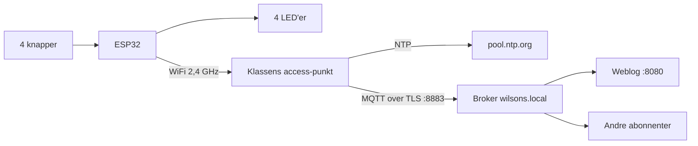
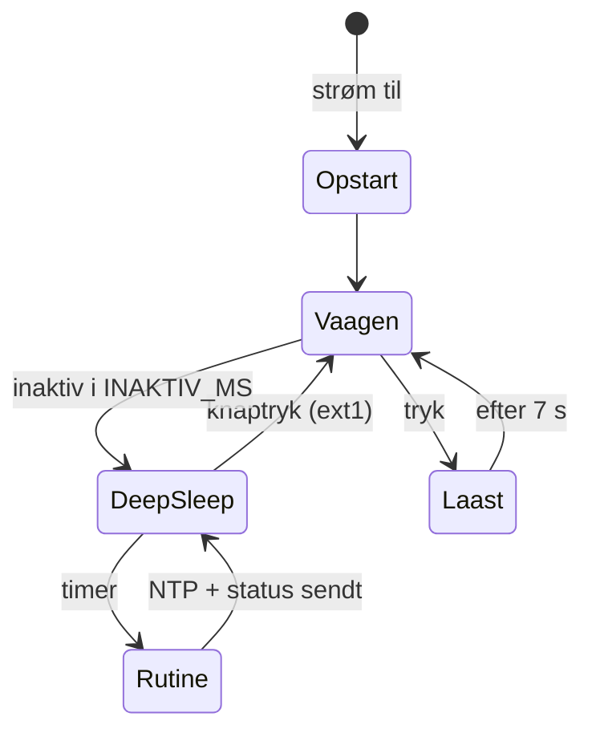

# Arbejds-portfolio – Smiley feedback-panel

**Fag:** IoT II (FAG 17682)
**Gruppe:** Hjalte
**Opgave:** [Projektopgave, Smiley feedback panel](https://s0ren.github.io/FAG_17682_IoT_II/Opgaver/Projektopgave_Smiley.html)

Portfolioen beskriver projektet fra idé over skitse til færdig løsning, og **hvorfor** vi har valgt som vi har.
Den opdateres løbende, når der er nyt indhold. Den daglige proces står i [logbog.md](logbog.md).

> ✏️ = afsnit vi selv mangler at udfylde (fotos, skitser, målinger, konklusioner).

---

## Indhold
1. [Idé og krav](#1-idé-og-krav)
2. [Hardware](#2-hardware)
3. [Systemoversigt](#3-systemoversigt)
4. [Firmware](#4-firmware)
5. [MQTT – topics og beskeder](#5-mqtt--topics-og-beskeder)
6. [Sikkerhed – TLS og login](#6-sikkerhed--tls-og-login)
7. [Tid – NTP og tidszone](#7-tid--ntp-og-tidszone)
8. [Strømbesparelse – deep sleep](#8-strømbesparelse--deep-sleep)
9. [Test](#9-test)
10. [Beslutningslog](#10-beslutningslog)
11. [Brug af AI](#11-brug-af-ai)
12. [Status og videre arbejde](#12-status-og-videre-arbejde)

---

## 1. Idé og krav

### Idé
Et feedback-panel som dem man kender fra lufthavne og butikker ("Happy or Not"): fire knapper med smileys fra glad til sur. Brugeren trykker én gang, og svaret sendes med tidsstempel til en MQTT-server, hvor det kan opsamles og analyseres.

✏️ *Indsæt evt. foto/skitse af den første idé.*

### Krav fra opgaven
| Krav | Hvordan vi løser det | Afsnit |
|---|---|---|
| 4 knapper med smileys | 4 trykknapper (grøn, blå, gul, rød) | [2](#2-hardware) |
| LED-respons | 1 LED ud for hver knap | [2](#2-hardware) |
| Debounce | Software-debounce, 50 ms stabilt signal | [4](#4-firmware) |
| 7 s spærretid, LED lyser hele tiden | Lås-tilstand i firmwaren | [4](#4-firmware) |
| WiFi via klassens access-punkt | ESP32 i station-mode, 2,4 GHz | [3](#3-systemoversigt) |
| Løbende NTP-synk, korrekt tidszone | SNTP + `CET-1CEST`-tidszone | [7](#7-tid--ntp-og-tidszone) |
| Knap-data (værdi + tid) via MQTT | JSON til `elever/<bruger>/smiley/tryk` | [5](#5-mqtt--topics-og-beskeder) |
| Brugernavn/kode + TLS | Port 8883, CA-certifikat, login | [6](#6-sikkerhed--tls-og-login) |
| Batteridrift med deep sleep + analyse | ext1- og timer-opvågning, målinger | [8](#8-strømbesparelse--deep-sleep) |

---

## 2. Hardware

### Komponenter
| Antal | Komponent | Bemærkning |
|---|---|---|
| 1 | ESP32 DevKit V1 (DOIT) | USB-chip CH9102 |
| 4 | Trykknap | grøn, blå, gul, rød |
| 4 | LED | samme farver som knapperne |
| 4 | Modstand 220 Ω | formodstand til LED |
| 4 | Pull-down-modstand | ✏️ *værdi, fx 10 kΩ* |
| 1 | Breadboard + ledninger | |

### Forbindelser
| Farve | Smiley | Værdi | Knap (GPIO) | LED (GPIO) |
|---|---|---|---|---|
| Grøn | Meget glad | 4 | 32 | 23 |
| Blå | Glad | 3 | 33 | 22 |
| Gul | Lidt sur | 2 | 25 | 21 |
| Rød | Meget sur | 1 | 26 | 19 |

- **Knap:** GPIO → knap → 3V3, og pull-down-modstand fra GPIO til GND. Trykket = `HIGH`.
- **LED:** GPIO → LED (langt ben) → 220 Ω → GND.

### Valg af ben
- Knapperne sidder på **RTC-GPIO'er** (25, 26, 32, 33). Kun RTC-GPIO'er kan vække ESP32 fra deep sleep, så det var et krav for at kunne bruge knaptryk som opvågning.
- Vi undgår **strapping-ben** (0, 2, 5, 12, 15), som kan forstyrre opstarten.
- Vi bruger **eksterne pull-down-modstande**, så knapperne holdes LOW, også mens chippen sover.

✏️ *Indsæt foto af den færdige opstilling og et diagram (fx tegnet i Fritzing/Wokwi eller i hånden).*

---

## 3. Systemoversigt



---

## 4. Firmware

Koden ligger i [`src/main.cpp`](../src/main.cpp). Bygges med PlatformIO, `espressif32@8.0.0`, Arduino-framework og biblioteket PubSubClient.

| Fil | Indhold | I git? |
|---|---|---|
| `src/main.cpp` | Al logik | Ja |
| `include/ca_cert.h` | Brokerens CA-certifikat (offentligt) | Ja |
| `include/secrets_eksempel.h` | Skabelon til hemmeligheder | Ja |
| `include/secrets.h` | WiFi-kode og MQTT-login | **Nej** (`.gitignore`) |

### Forløb


1. **Opvågning:** ved et knaptryk tænder LED'en straks, og trykket gemmes med tidsstempel i en kø i RTC-hukommelsen.
2. **Net:** WiFi forbindes i baggrunden (ikke-blokerende), derefter NTP og MQTT.
3. **Afsendelse:** køen tømmes. Tryk der ikke kan sendes, bliver i køen til næste vågning.
4. **Lås:** i 7 s ignoreres nye tryk, og LED'en lyser.
5. **Søvn:** når der ikke har været aktivitet i `INAKTIV_MS`, og ingen knap holdes nede, går den i deep sleep.

### Debounce
En knap regnes først som trykket, når signalet har været stabilt i **50 ms**. Hver gang signalet skifter, starter tælleren forfra, så prel fra kontakten bliver filtreret fra. Kun overgangen LOW → HIGH tæller som et tryk, så det ikke giver flere tryk at holde knappen nede.

### Indstillinger
| Konstant | Værdi | Betydning |
|---|---|---|
| `DEBOUNCE_MS` | 50 ms | Debounce-tid |
| `LAAS_MS` | 7000 ms | Spærretid efter tryk (krav) |
| `INAKTIV_MS` | 30000 ms | Vågen uden aktivitet før deep sleep – ✏️ *bestemmes i afsnit 8* |
| `RUTINE_SOVETID_S` | 6 t | Tid mellem rutine-vågninger – ✏️ *bestemmes i afsnit 8* |
| `NET_TIMEOUT_MS` | 20000 ms | Opgiv net og sov (tryk gemmes) |
| `NTP_VENT_MS` | 4000 ms | Max ventetid på NTP før afsendelse |

---

## 5. MQTT – topics og beskeder

Broker: `wilsons.local` (192.168.0.33). Vi må kun skrive under `elever/<brugernavn>/`.

| Topic | Hvornår |
|---|---|
| `elever/<bruger>/smiley/tryk` | Ved hvert knaptryk |
| `elever/<bruger>/smiley/status` | Ved opstart og rutine-vågning |

### Tryk
```json
{
  "enhed": "bruger-a1b2c3",
  "knap": "groen",
  "vaerdi": 4,
  "tid": "2026-11-24T10:15:03.123+01:00",
  "epoch_ms": 1795511703123,
  "ntp_synk": true
}
```
| Felt | Betydning |
|---|---|
| `enhed` | Unikt klient-ID: brugernavn + del af MAC-adressen |
| `knap` / `vaerdi` | Hvilken knap, og 4 (glad) … 1 (sur) |
| `tid` | Lokal tid (ISO 8601) med ms og tidszone |
| `epoch_ms` | Samme tidspunkt i ms siden 1970 (UTC) – nemt at regne med |
| `ntp_synk` | `true` = tiden er rettet efter NTP i samme vågning |

### Status
```json
{"enhed":"...","haendelse":"rutine","tid":"...","boot":12,"rssi":-58,"koe":0,"forrige_vaagen_ms":31250,"ntp_synk":true,"tls":true}
```
`boot` og `forrige_vaagen_ms` bruges i analysen af strømforbruget.

### Hvorfor JSON?
Det er let at læse for både mennesker og programmer, felterne har navne, og man kan tilføje felter uden at ødelægge eksisterende modtagere.

---

## 6. Sikkerhed – TLS og login

| | Port 1883 | Port 8883 (vores løsning) |
|---|---|---|
| Kryptering | Ingen – alle på nettet kan læse med | TLS |
| Login | Nej – alle kan skrive alt | Brugernavn + kode |
| Adgangskontrol | Ingen | Vi kan kun skrive til `elever/<bruger>/#` |

### Sådan virker det
1. ESP32 kender brokerens **CA-certifikat** (`ca.crt`, `CN=MQTT-CA TEC IOT 2026`, gyldigt til 2036).
2. Ved forbindelsen tjekker ESP32, at brokerens certifikat er **underskrevet af den CA** og at **værtsnavnet** passer. Derfor forbinder vi med `wilsons.local` og ikke IP-adressen.
3. Først når TLS-forbindelsen er krypteret, sendes brugernavn og kode – de kan derfor ikke opsnappes.

### Valg
- **Ingen `setInsecure()`:** det ville slå certifikat-tjekket fra, så en falsk server kunne udgive sig for at være brokeren.
- **Hemmeligheder uden for git:** `secrets.h` står i `.gitignore`. Kun skabelonen `secrets_eksempel.h` committes.
- **CA-certifikatet må gerne i git:** det er offentligt og indeholder ingen nøgle.
- **Midlertidig kontakt `BRUG_TLS`:** mens vi ventede på login, kørte vi med `BRUG_TLS 0` (port 1883). Koden giver en advarsel ved hver build, og statusbeskeden viser `"tls": false`, så det ikke bliver glemt.

✏️ *Indsæt screenshot af seriel log med `MQTT forbundet (TLS verificeret mod CA)`, når TLS er testet.*

---

## 7. Tid – NTP og tidszone

- Tidszone: `CET-1CEST,M3.5.0,M10.5.0/3` = dansk tid, sommertid fra sidste søndag i marts til sidste søndag i oktober.
- NTP-servere: `pool.ntp.org`, `time.google.com`.
- **Løbende synk:** ved hver vågning, hver time mens den er vågen, og ved rutine-vågning.
- **Under deep sleep** kører ESP32's RTC-ur videre, men det skrider. Derfor:
  - Tidsstemplet tages **ved trykket** (fra RTC-uret).
  - Når NTP har synkroniseret, regnes tidsstemplet om: `NTP-tid nu − (millis() nu − millis() ved tryk)`. Så får trykket præcis tid, selvom RTC-uret var skredet.
  - Feltet `ntp_synk` viser, om rettelsen er sket.
- Tidszonen skal sættes igen ved hver opvågning, fordi miljøvariablen `TZ` ikke overlever deep sleep.

✏️ *Målt drift af RTC-uret: ___ sekunder pr. time (se afsnit 8).*

---

## 8. Strømbesparelse – deep sleep

### Design
| Opvågning | Kilde | Hvad sker der |
|---|---|---|
| Knaptryk | ext1 på GPIO 25, 26, 32, 33 (vilkårlig HIGH) | `esp_sleep_get_ext1_wakeup_status()` fortæller **hvilken** knap – trykket registreres med det samme |
| Rutine | Timer, `RUTINE_SOVETID_S` | NTP-synk, statusbesked, tøm kø, sov straks igen |
| Strøm til / reset | – | LED-test, NTP, statusbesked |

Data der skal overleve søvnen (kø af tryk, boot-tæller, vågen-tid) ligger i **RTC-hukommelse** (`RTC_DATA_ATTR`).

### Forsøg
✏️ *Udfyldes med egne målinger.*

**Opstilling:** ✏️ *fx USB-strømmeter mellem PC og board / multimeter i serie med forsyningen.*

| Tilstand | Strøm (mA) | Varighed |
|---|---|---|
| Deep sleep | | – |
| Vågen, WiFi forbundet, inaktiv | | – |
| Opvågning → WiFi forbundet | | ms |
| WiFi → MQTT forbundet (TLS) | | ms |
| Tryk → besked sendt (fra seriel log) | | ms |

### Analyse af inaktiv-tid (`INAKTIV_MS`)
At blive vågen koster strøm, men det gør det også at vågne og forbinde igen.

- Energi for at vågne og forbinde: `E_vaagn = I_opstart × t_opstart`
- Energi pr. sekund vågen: `I_inaktiv`
- **Break-even:** `t = E_vaagn / I_inaktiv`. Kommer næste tryk typisk inden for `t` sekunder, kan det betale sig at blive vågen.

✏️ *Beregning med vores tal, og den valgte værdi med begrundelse.*

### Analyse af rutine-sovetid (`RUTINE_SOVETID_S`)
- Hvor meget skrider RTC-uret pr. time? ✏️
- Hvor meget koster en rutine-vågning? ✏️
- Valgt værdi og begrundelse: ✏️

### Batterilevetid
✏️ *Beregn levetid for et batteri (fx 2000 mAh) ved fx 50 og 500 tryk pr. dag.*

### Kendt begrænsning
Selv i deep sleep bruger DevKit-boardet flere mA, fordi USB-chippen, spændingsregulatoren og power-LED'en fortsat trækker strøm. Selve ESP32-chippen bruger kun omkring 10 µA. Et rigtigt batteriprodukt ville bruge et board uden de komponenter.

---

## 9. Test

| # | Test | Forventet | Resultat |
|---|---|---|---|
| 1 | Hver knap tænder sin LED (testprogram) | Alle 4 virker | ✅ |
| 2 | Firmware uploadet og kører | Logger opstart | ✅ |
| 3 | Tryk → besked i weblog (`http://wilsons.local:8080/`) | JSON med korrekt knap og tid | ✏️ |
| 4 | Tryk under lås | Ignoreres, LED lyser 7 s | ✏️ |
| 5 | Hurtige prel på knap | Kun ét tryk registreres | ✏️ |
| 6 | Inaktiv i `INAKTIV_MS` | Går i deep sleep, LED'er slukket | ✏️ |
| 7 | Tryk mens den sover | Vågner, registrerer rigtig knap, sender | ✏️ |
| 8 | Rutine-vågning (kort tid under test) | Statusbesked, `boot` stiger | ✏️ |
| 9 | Intet net (forkert vært) | Tryk gemmes og sendes ved næste vågning | ✏️ |
| 10 | Tidsstempel efter vågning | Korrekt dansk tid, `ntp_synk: true` | ✏️ |
| 11 | TLS + login (`BRUG_TLS 1`) | `MQTT forbundet (TLS verificeret mod CA)` | ✏️ |
| 12 | Forkert kode | `rc=5` (Not authorized) | ✏️ |

✏️ *Indsæt screenshots af seriel log og weblog.*

---

## 10. Beslutningslog

| Dato | Beslutning | Begrundelse |
|---|---|---|
| 2026-11-24 | Knapper på RTC-GPIO 25, 26, 32, 33 | Kun RTC-GPIO kan vække fra deep sleep |
| 2026-11-24 | Eksterne pull-down-modstande | Holder knapperne LOW, også i deep sleep |
| 2026-11-24 | Grøn = 4 … rød = 1 | Højere tal = mere tilfreds, nemt at lave gennemsnit |
| 2026-11-24 | JSON som beskedformat | Læsbart, navngivne felter, kan udvides |
| 2026-11-24 | Tidsstempel = tidspunkt for trykket, rettet efter NTP | Afsendelse sker flere sekunder senere efter opvågning |
| 2026-11-24 | Kø i RTC-hukommelse | Tryk må ikke gå tabt, hvis nettet er nede |
| 2026-11-24 | Forbind med værtsnavn, ikke IP | Certifikat-tjekket kræver værtsnavnet |
| 2026-11-24 | Midlertidigt `BRUG_TLS 0` | Venter på login; skal tilbage til `1` |
| | ✏️ | |

---

## 11. Brug af AI

Vi har brugt Claude Code (AI) til at læse opgaven og MQTT-siden igennem, skrive første udgave af firmwaren og lave skabeloner til logbog og portfolio. Vi har selv bygget hardwaren, testet på boardet og truffet beslutningerne ovenfor.
✏️ *Beskriv kort, hvad I selv har ændret, testet og forstået – og hvad I har lært af det.*

---

## 12. Status og videre arbejde

- [x] Hardware bygget og testet
- [x] Firmware med debounce, lås, WiFi, NTP, MQTT og deep sleep
- [x] Firmware testet på boardet uden TLS
- [ ] Få login og teste med TLS (`BRUG_TLS 1`)
- [ ] Forsøg og analyse af deep sleep
- [ ] Vælge og begrunde `INAKTIV_MS` og `RUTINE_SOVETID_S`
- [ ] Fotos, diagram og screenshots
- [ ] Git-repo med læreren tilføjet
