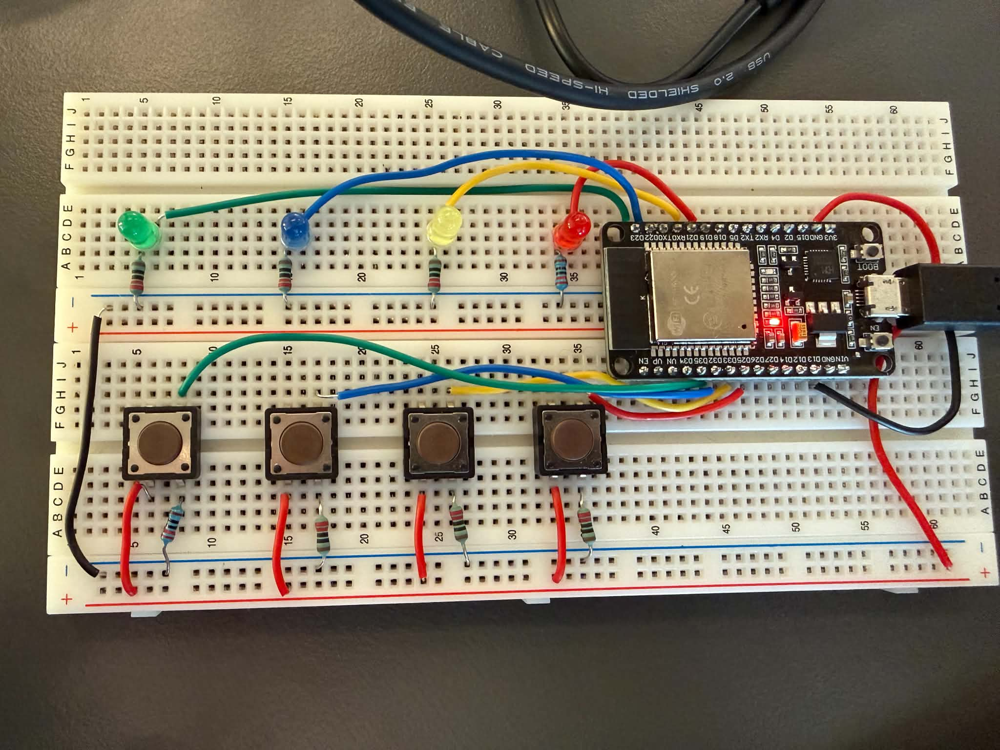
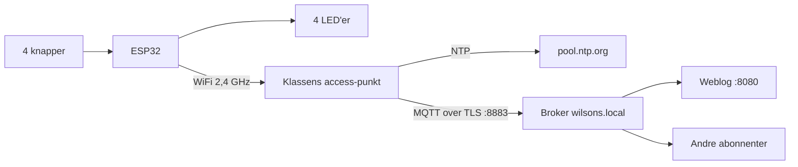
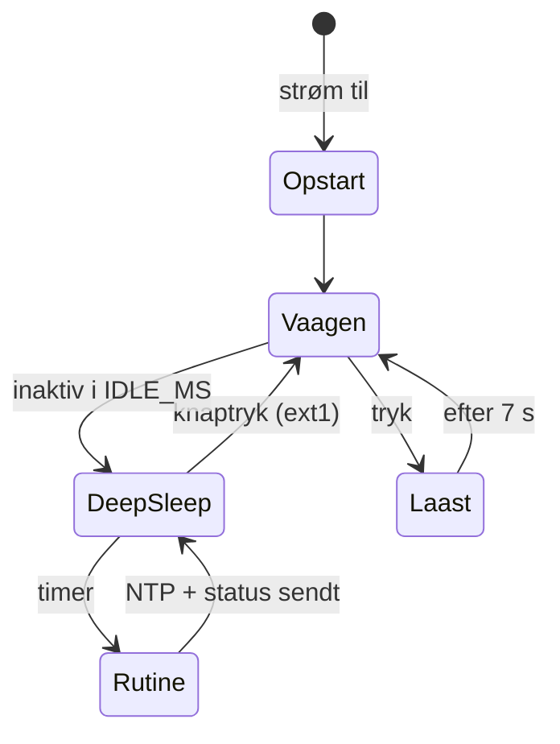
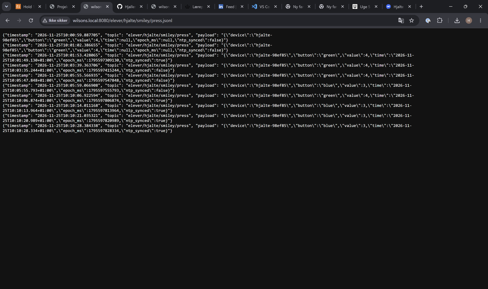

# Arbejds-portfolio – Smiley feedback-panel

**Fag:** IoT II (FAG 17682)
**Gruppe:** Hjalte
**Opgave:** [Projektopgave, Smiley feedback panel](https://s0ren.github.io/FAG_17682_IoT_II/Opgaver/Projektopgave_Smiley.html)

Portfolioen beskriver projektet fra idé over skitse til færdig løsning, og **hvorfor** vi har valgt som vi har.
Den opdateres løbende, når der er nyt indhold. Den daglige proces står i [logbog.md](logbog.md).

> ✏️ = afsnit vi selv mangler at udfylde (fotos, skitser, målinger, konklusioner).

---

## Indhold
1. [Idé og krav](#1-idé-og-krav)
2. [Hardware](#2-hardware)
3. [Systemoversigt](#3-systemoversigt)
4. [Firmware](#4-firmware)
5. [MQTT – topics og beskeder](#5-mqtt--topics-og-beskeder)
6. [Sikkerhed – TLS og login](#6-sikkerhed--tls-og-login)
7. [Tid – NTP og tidszone](#7-tid--ntp-og-tidszone)
8. [Strømbesparelse – deep sleep](#8-strømbesparelse--deep-sleep)
9. [Test](#9-test)
10. [Beslutningslog](#10-beslutningslog)
11. [Brug af AI](#11-brug-af-ai)
12. [Status og videre arbejde](#12-status-og-videre-arbejde)

---

## 1. Idé og krav

### Idé
Et feedback-panel som dem man kender fra lufthavne og butikker ("Happy or Not"): fire knapper med smileys fra glad til sur. Brugeren trykker én gang, og svaret sendes med tidsstempel til en MQTT-server, hvor det kan opsamles og analyseres.

✏️ *Indsæt evt. foto/skitse af den første idé.*

### Krav fra opgaven
| Krav | Hvordan vi løser det | Afsnit |
|---|---|---|
| 4 knapper med smileys | 4 trykknapper (grøn, blå, gul, rød) | [2](#2-hardware) |
| LED-respons | 1 LED ud for hver knap | [2](#2-hardware) |
| Debounce | Software-debounce, 50 ms stabilt signal | [4](#4-firmware) |
| 7 s spærretid, LED lyser hele tiden | Lås-tilstand i firmwaren | [4](#4-firmware) |
| WiFi via klassens access-punkt | ESP32 i station-mode, 2,4 GHz | [3](#3-systemoversigt) |
| Løbende NTP-synk, korrekt tidszone | SNTP + `CET-1CEST`-tidszone | [7](#7-tid--ntp-og-tidszone) |
| Knap-data (værdi + tid) via MQTT | JSON til `elever/<bruger>/smiley/press` | [5](#5-mqtt--topics-og-beskeder) |
| Brugernavn/kode + TLS | Port 8883, CA-certifikat, login | [6](#6-sikkerhed--tls-og-login) |
| Batteridrift med deep sleep + analyse | ext1- og timer-opvågning, målinger | [8](#8-strømbesparelse--deep-sleep) |

---

## 2. Hardware

### Komponenter
| Antal | Komponent | Bemærkning |
|---|---|---|
| 1 | ESP32 DevKit V1 (DOIT) | USB-chip CH9102 |
| 4 | Trykknap | grøn, blå, gul, rød |
| 4 | LED | samme farver som knapperne |
| 4 | Modstand 220 Ω | formodstand til LED |
| 4 | Pull-down-modstand | 220Ω |
| 1 | Breadboard + ledninger | |

### Forbindelser
| Farve | Smiley | Værdi | Knap (GPIO) | LED (GPIO) |
|---|---|---|---|---|
| Grøn | Meget glad | 4 | 32 | 23 |
| Blå | Glad | 3 | 33 | 22 |
| Gul | Lidt sur | 2 | 25 | 21 |
| Rød | Meget sur | 1 | 26 | 19 |

- **Knap:** GPIO → knap → 3V3, og pull-down-modstand fra GPIO til GND. Trykket = `HIGH`.
- **LED:** GPIO → LED (langt ben) → 220 Ω → GND.

### Valg af ben
- Knapperne sidder på **RTC-GPIO'er** (25, 26, 32, 33). Kun RTC-GPIO'er kan vække ESP32 fra deep sleep, så det var et krav for at kunne bruge knaptryk som opvågning.
- Vi undgår **strapping-ben** (0, 2, 5, 12, 15), som kan forstyrre opstarten.
- Vi bruger **eksterne pull-down-modstande**, så knapperne holdes LOW, også mens chippen sover.



*LED'er med formodstand øverst, knapper med pull-down-modstand nederst, ESP32 til højre.*

✏️ *Evt. diagram (fx tegnet i Fritzing/Wokwi eller i hånden).*

---

## 3. Systemoversigt



---

## 4. Firmware

Koden ligger i [`src/main.cpp`](../src/main.cpp). Bygges med PlatformIO, `espressif32@8.0.0`, Arduino-framework og biblioteket PubSubClient.

| Fil | Indhold | I git? |
|---|---|---|
| `src/main.cpp` | Al logik | Ja |
| `include/ca_cert.h` | Brokerens CA-certifikat (offentligt) | Ja |
| `include/secrets_example.h` | Skabelon til hemmeligheder | Ja |
| `include/secrets.h` | WiFi-kode og MQTT-login | **Nej** (`.gitignore`) |

### Forløb


1. **Opvågning:** ved et knaptryk tænder LED'en straks, og trykket gemmes med tidsstempel i en kø i RTC-hukommelsen.
2. **Net:** WiFi forbindes i baggrunden (ikke-blokerende), derefter NTP og MQTT.
3. **Afsendelse:** køen tømmes. Tryk der ikke kan sendes, bliver i køen til næste vågning.
4. **Lås:** i 7 s ignoreres nye tryk, og LED'en lyser.
5. **Søvn:** når der ikke har været aktivitet i `IDLE_MS`, og ingen knap holdes nede, går den i deep sleep.

### Debounce
En knap regnes først som trykket, når signalet har været stabilt i **50 ms**. Hver gang signalet skifter, starter tælleren forfra, så prel fra kontakten bliver filtreret fra. Kun overgangen LOW → HIGH tæller som et tryk, så det ikke giver flere tryk at holde knappen nede.

### Indstillinger
| Konstant | Værdi | Betydning |
|---|---|---|
| `DEBOUNCE_MS` | 50 ms | Debounce-tid |
| `LOCK_MS` | 7000 ms | Spærretid efter tryk (krav) |
| `IDLE_MS` | **10000 ms** (var 30000 ms til og med test 16) | Vågen uden aktivitet før deep sleep – se [afsnit 8](#analyse-af-inaktiv-tid-idle_ms) |
| `ROUTINE_SLEEP_S` | **6 t** (valgt) | Tid mellem rutine-vågninger – se [afsnit 8](#analyse-af-rutine-sovetid-routine_sleep_s) |
| `NET_TIMEOUT_MS` | 20000 ms | Opgiv net og sov (tryk gemmes) |
| `NTP_WAIT_MS` | **17000 ms** (var 4000 ms til og med test 17b) | Max ventetid på NTP (fra WiFi er oppe) før et tryk sendes med RTC-tid |

---

## 5. MQTT – topics og beskeder

Broker: `wilsons.local` (192.168.0.33). Vi må kun skrive under `elever/<brugernavn>/`.

| Topic | Hvornår |
|---|---|
| `elever/<bruger>/smiley/press` | Ved hvert knaptryk |
| `elever/<bruger>/smiley/status` | Ved opstart og rutine-vågning |

### Tryk
```json
{
  "device": "bruger-a1b2c3",
  "button": "green",
  "value": 4,
  "time": "2026-11-25T10:15:03.123+01:00",
  "epoch_ms": 1795598103123,
  "ntp_synced": true
}
```
| Felt | Betydning |
|---|---|
| `device` | Unikt klient-ID: brugernavn + del af MAC-adressen |
| `button` / `value` | Hvilken knap (`green`, `blue`, `yellow`, `red`), og 4 (glad) … 1 (sur) |
| `time` | Lokal tid (ISO 8601) med ms og tidszone |
| `epoch_ms` | Samme tidspunkt i ms siden 1970 (UTC) – nemt at regne med |
| `ntp_synced` | `true` = tiden er rettet efter NTP |

### Status
```json
{"device":"...","event":"routine","time":"...","boot":12,"rssi":-58,"queue":0,"prev_awake_ms":31250,"ntp_synced":true,"tls":true}
```
`event` er `startup` (strøm til/reset) eller `routine` (rutine-vågning). `boot` og `prev_awake_ms` bruges i analysen af strømforbruget.

### Skift til engelsk (2026-11-25)
Koden, JSON-felterne og tryk-topic'et blev oversat til engelsk 2026-11-25. **Målinger, log-citater og weblog-data fra før det tidspunkt bruger de danske navne** og står uændret i portfolioen, fordi de dokumenterer, hvad der faktisk skete. Oversigt:

| Før (dansk) | Nu (engelsk) |
|---|---|
| topic `.../smiley/tryk` | `.../smiley/press` |
| `enhed`, `knap`, `vaerdi`, `tid` | `device`, `button`, `value`, `time` |
| `groen`, `blaa`, `gul`, `roed` | `green`, `blue`, `yellow`, `red` |
| `ntp_synk` | `ntp_synced` |
| `haendelse` (`opstart` / `rutine`) | `event` (`startup` / `routine`) |
| `koe`, `forrige_vaagen_ms` | `queue`, `prev_awake_ms` |
| Log: `Sendt`, `Laas ophaevet`, `Vaagnet af knap` | `Sent`, `Lock released`, `Woken by button` |
| Log: `MQTT forbundet`, `MQTT login afvist` | `MQTT connected`, `MQTT login rejected` |
| Log: `NTP synk - RTC-uret var ... forkert` | `NTP sync - RTC clock was off by ...` |
| Log: `... tryk gemmes til naeste vaagning` | `... presses kept for next wake-up` |
| `BRUG_TLS`, `MQTT_VAERT`, `INAKTIV_MS`, `RUTINE_SOVETID_S`, `NTP_VENT_MS` | `USE_TLS`, `MQTT_HOST`, `IDLE_MS`, `ROUTINE_SLEEP_S`, `NTP_WAIT_MS` |
| `secrets_eksempel.h`, `analyse/strom_estimat.py` | `secrets_example.h`, `analyse/power_estimate.py` |

(Konstanternes nye navne er også brugt i de ældre afsnit, så teksten passer med koden.)

### Hvorfor JSON?
Det er let at læse for både mennesker og programmer, felterne har navne, og man kan tilføje felter uden at ødelægge eksisterende modtagere.

---

## 6. Sikkerhed – TLS og login

| | Port 1883 | Port 8883 (vores løsning) |
|---|---|---|
| Kryptering | Ingen – alle på nettet kan læse med | TLS |
| Login | Nej – alle kan skrive alt | Brugernavn + kode |
| Adgangskontrol | Ingen | Vi kan kun skrive til `elever/<bruger>/#` |

### Sådan virker det
1. ESP32 kender brokerens **CA-certifikat** (`ca.crt`, `CN=MQTT-CA TEC IOT 2026`, gyldigt til 2036).
2. Ved forbindelsen tjekker ESP32, at brokerens certifikat er **underskrevet af den CA** og at **værtsnavnet** passer. Derfor forbinder vi med `wilsons.local` og ikke IP-adressen.
3. Først når TLS-forbindelsen er krypteret, sendes brugernavn og kode – de kan derfor ikke opsnappes.

### Valg
- **Ingen `setInsecure()`:** det ville slå certifikat-tjekket fra, så en falsk server kunne udgive sig for at være brokeren.
- **Hemmeligheder uden for git:** `secrets.h` står i `.gitignore`. Kun skabelonen `secrets_example.h` committes.
- **CA-certifikatet må gerne i git:** det er offentligt og indeholder ingen nøgle.
- **Midlertidig kontakt `USE_TLS`:** mens vi ventede på login, kørte vi med `USE_TLS 0` (port 1883). Koden giver en advarsel ved hver build, og statusbeskeden viser `"tls": false`, så det ikke bliver glemt. **TLS er slået til igen (`USE_TLS 1`) fra 2026-11-25**, efter vi fik login af læreren.

✏️ *Indsæt screenshot af seriel log med `TLS up after ... ms (CA verified)` og `MQTT connected`.*

---

## 7. Tid – NTP og tidszone

- Tidszone: `CET-1CEST,M3.5.0,M10.5.0/3` = dansk tid, sommertid fra sidste søndag i marts til sidste søndag i oktober.
- NTP-servere: `pool.ntp.org`, `time.google.com`.
- **Løbende synk:** ved hver vågning, hver 3. time mens den er vågen (ESP-IDF-standard, `CONFIG_LWIP_SNTP_UPDATE_DELAY` = 10.800.000 ms), og ved rutine-vågning.
- **Hvorfor NTP nogle gange er langsom:** ESP-IDF venter med vilje et **tilfældigt tidsrum på 0–5 s**, før den første NTP-forespørgsel sendes (`CONFIG_LWIP_SNTP_STARTUP_DELAY` = y, `CONFIG_LWIP_SNTP_MAXIMUM_STARTUP_DELAY` = 5000 ms), så mange enheder ikke spørger serveren på samme tid efter fx et strømsvigt. Firmwaren ventede først højst 4 s (`NTP_WAIT_MS`), så i ca. 20 % af opvågningerne nåede NTP ikke frem i tide (NTP tog 1,3–4,0 s, og 2 af ca. 10 opvågninger fik `ntp_synk: false`). Går UDP-pakken tabt, prøver SNTP først igen efter 15 s (`SNTP_RECV_TIMEOUT`) – det så vi i test 17 og 17b, hvor NTP først kom ca. 17 s efter WiFi.
- **Ny ventetid (2026-11-25): `NTP_WAIT_MS` = 17 s.** Uden NTP får trykket RTC-tid, og den er ca. 1,3 % for hurtig: 0,2 s efter 14 s søvn, men **ca. 5 min efter 6 timers søvn**. Efter et tryk er enheden alligevel vågen i mindst 17 s (7 s lås + 10 s `IDLE_MS`), så ventetiden koster normalt ingen ekstra vågen-tid. Ulempen er, at beskeden kan nå brokeren op til ca. 18 s efter trykket – men tidsstemplet er stadig tidspunktet for **trykket**. Kommer NTP sent, holder enheden sig vågen `IDLE_MS` efter afsendelsen (afsendelse tæller som aktivitet), så en forsinket pakke når frem. Det koster ca. 11 s ekstra vågen-tid (ca. 0,15 mAh) – kun i de opvågninger, hvor NTP er langsom.
- **Under deep sleep** kører ESP32's RTC-ur videre, men det skrider. Derfor:
  - Tidsstemplet tages **ved trykket** (fra RTC-uret).
  - Når NTP har synkroniseret, regnes tidsstemplet om: `NTP-tid nu − (millis() nu − millis() ved tryk)`. Så får trykket præcis tid, selvom RTC-uret var skredet.
  - Feltet `ntp_synced` viser, om rettelsen er sket.
- Tidszonen skal sættes igen ved hver opvågning, fordi miljøvariablen `TZ` ikke overlever deep sleep.

✏️ *Målt drift af RTC-uret: ___ sekunder pr. time (se afsnit 8).*

---

## 8. Strømbesparelse – deep sleep

### Design
| Opvågning | Kilde | Hvad sker der |
|---|---|---|
| Knaptryk | ext1 på GPIO 25, 26, 32, 33 (vilkårlig HIGH) | `esp_sleep_get_ext1_wakeup_status()` fortæller **hvilken** knap – trykket registreres med det samme |
| Rutine | Timer, `ROUTINE_SLEEP_S` | NTP-synk, statusbesked, tøm kø, sov straks igen |
| Strøm til / reset | – | LED-test, NTP, statusbesked |

Data der skal overleve søvnen (kø af tryk, boot-tæller, vågen-tid) ligger i **RTC-hukommelse** (`RTC_DATA_ATTR`).

### Forsøg 1 – Tider fra opvågning til afsendelse (2026-11-24)

**Opstilling:** board forsynet via USB fra PC, seriel monitor på 115200 baud. `USE_TLS 0` (port 1883), `IDLE_MS` = 30 s, `NTP_WAIT_MS` = 4 s. Tiderne er aflæst i den serielle log (`millis()` fra programstart – bootloaderens tid før programstart er ikke med).

**Målinger – vågnet af knaptryk:**

| Boot | Vågen → knap fundet + LED | Vågen → WiFi | WiFi → MQTT | WiFi → sendt | **Vågen → sendt** | NTP nået |
|---|---|---|---|---|---|---|
| 4 | 42 ms | 1146 ms | 42 ms | 2311 ms | **3457 ms** | ja |
| 5 | 42 ms | 1151 ms | 41 ms | 1310 ms | **2461 ms** | ja |
| 6 | 42 ms | 1156 ms | 42 ms | 4006 ms | **5162 ms** | **nej** |
| 7 | 42 ms | 1151 ms | 54 ms | 3749 ms | **4900 ms** | ja |
| **Gns.** | **42 ms** | **1151 ms** | **45 ms** | **2844 ms** | **3995 ms** | 3 af 4 |

**Målinger – allerede vågen og forbundet (boot 5 og 7):**
8 tryk (7 i boot 5, 1 i boot 7). Fra tryk til `Sendt` i loggen: **2–3 ms** hver gang.

### Forsøg 1b – Fra tryk til modtaget på brokeren
Brokerens weblog sætter sit eget tidsstempel på hver besked (`timestamp`). Forskellen til enhedens `tid` er tiden **fra tryk til beskeden er modtaget** – inkl. netværket. 22 beskeder fra 2026-11-24 (se [screenshot](billeder/test3b_weblog.png)):

| Situation | Antal | Tryk → modtaget på broker |
|---|---|---|
| Allerede vågen og forbundet | 13 | **15–22 ms** |
| Vågnet fra deep sleep (NTP nået) | 8 | **2,3–4,9 s**, gns. **3,4 s** |
| Vågnet fra deep sleep, NTP ikke nået (boot 6) | 1 | 4,7 s – se nedenfor |
| Uafklaret (ingen seriel log fra den periode) | 1 | 276 ms |

For de tryk der også er i den serielle log, passer det: fx boot 4 → `Sendt` 3415 ms efter trykket, modtaget på brokeren 3430 ms efter trykket. **Netværket fra ESP32 til broker tager ca. 15–20 ms.**

### Målinger af RTC-urets drift
Når NTP ikke når frem (`ntp_synk: false`), er `tid` RTC-urets tid uden rettelse. Ved at sammenligne med brokerens tidsstempel og den serielle log kan driften beregnes:

`forventet (broker − tid)` = tryk → `Sendt` (seriel log) + netværk (ca. 15–40 ms)
`drift` = forventet − målt

| Dato / boot | Søvn før tryk | Tryk → `Sendt` | Forventet broker − tid | Målt broker − tid | RTC-uret gik for hurtigt | Drift |
|---|---|---|---|---|---|---|
| 24/11 boot 6 (uden TLS) | ca. 37 s (12:47:44 → 12:48:21) | 5120 ms | ca. 5137 ms | 4665 ms | ca. 0,47 s | **ca. 1,3 %** |
| 25/11 boot 4 (TLS) | ca. 3,8 s (08:04:12,8 → 08:04:16,6) | 5118 ms | ca. 5148 ms | 5100 ms | ca. 0,05 s | **ca. 1,3 %** (±0,4 % pga. usikkerhed på netværkstiden) |

**Direkte måling i firmwaren (fra 25/11):** ved første NTP-synk efter opvågning logger firmwaren selv forskellen mellem RTC-urets tid og NTP-tiden. Det er mere præcist end metoden ovenfor, fordi netværkstiden ikke indgår.

| Dato / boot | Søvn | RTC-uret gik for hurtigt | Drift |
|---|---|---|---|
| 25/11 boot 2 | 1221,7 s (20,4 min) | **20,6 s** | **1,68 %** |
| 25/11 kl. 09:33, rutine (test 9) | 59,2 s | **0,861 s** | **1,45 %** |
| 25/11 kl. 09:35, rutine (test 9) | 59,2 s | **0,868 s** | **1,47 %** |
| 25/11, test 16 boot 2 | 38,9 s | **0,478 s** | **1,23 %** |
| 25/11, test 16 boot 3 | 14,7 s | **0,203 s** | **1,38 %** |
| 25/11, test 15b boot 2 | 87,5 s | **1,133 s** | **1,30 %** |
| 25/11, test 17 boot 2 | 14,4 s | **0,184 s** | **1,28 %** |
| 25/11, test 17b boot 2 | 13,6 s | **0,186 s** | **1,37 %** |
| ✏️ | ✏️ *fx 1 time* | | |

Seriel log: `NTP synk - RTC-uret var +20578 ms forkert efter 1221.7 s deep sleep (1.68 %)` og `NTP sync - RTC clock was off by +861 ms after 59.2 s deep sleep (1.45 %)`

**Krydstjek:** i test 9 var rutine-timeren sat til 60 s, men den målte søvn var kun **59,2 s**. Timeren tæller med RTC-uret, og når det går ca. 1,46 % for hurtigt, varer "60 s" kun 60 / 1,0146 ≈ **59,1 s** i virkeligheden. Det passer med målingen og bekræfter driften på en helt uafhængig måde.

**Konklusion:** alle målinger viser, at RTC-uret går **ca. 1,2–1,7 % for hurtigt** under deep sleep, og at driften vokser med søvnens længde. Firmwarens egne målinger giver 1,23–1,68 % (8 målinger, 15 s – 20 min søvn). Ved kort søvn er usikkerheden størst, fordi få millisekunders unøjagtighed fylder mere. Variationen kan også skyldes temperatur, som RC-oscillatoren er følsom over for. Det betyder ca. **20 s pr. 20 min** og ca. **6 min pr. 6 timer**. ESP32's RTC-ur kører under deep sleep på en intern RC-oscillator (ca. 150 kHz), som er langt mindre præcis end krystallen, der bruges når chippen er vågen.

Det betyder:
- **Tryk der sendes med `ntp_synk: false` efter lang søvn, kan have et tidsstempel, der er flere minutter forkert.** NTP er derfor nødvendig efter hver opvågning – ikke kun ved rutine-vågning.
- **Man kan ikke springe NTP-ventetiden over** efter en lang søvn. Den foreslåede optimering virker kun efter kort søvn (fx under 1 min, hvor fejlen er under 1 s).
- **En kortere `ROUTINE_SLEEP_S` hjælper ikke meget,** da driften sker under al søvn, og rettelsen alligevel sker ved hver opvågning. Den begrænser kun, hvor stor fejlen højst kan blive, hvis NTP svigter.
- **Mulige forbedringer (ikke implementeret):**
  - *Software-kompensation:* firmwaren kender nu driften fra sidste måling og kunne trække fx 1,68 % af søvnens længde fra urets tid, når NTP ikke når frem.
  - *Ekstern 32 kHz-krystal:* ESP32 kan bruge en urkrystal under deep sleep, som er langt mere præcis – men den skal sidde på **GPIO 32 og 33**, som vi bruger til knapperne. Det ville kræve, at to knapper flyttes til andre RTC-GPIO'er (fx 27 og 14).

**Vågen-tid pr. session:**

| Boot | Antal tryk | Vågen i alt |
|---|---|---|
| 4 | 1 | 37,0 s |
| 5 | 8 | 100,8 s |
| 6 | 1 | 37,0 s |
| 7 | 2 | 44,3 s |

Ét tryk giver ca. 37 s vågen-tid: ca. 4 s net og afsendelse, 3 s mere til låsen udløber efter 7 s, og derefter 30 s inaktiv-tid.

### Observationer
1. **Hurtig reaktion:** opvågningsårsagen og den rigtige knap findes, og LED'en tænder, 42 ms efter programstart. ✏️ *Mål den reelle forsinkelse fra tryk til LED med slowmotion-video (inkl. bootloader).*
2. **WiFi er stabilt:** 1146–1156 ms hver gang.
3. **MQTT uden TLS er hurtigt:** ca. 45 ms. Med TLS tager det typisk ca. 0,7 s – se [forsøg 1c](#forsøg-1c--med-tls-2026-11-25).
4. **NTP er flaskehalsen:** firmwaren venter op til 4 s på NTP, før trykket sendes. Det tog 1,3–4,0 s – i gennemsnit **ca. 70 %** af tiden fra opvågning til afsendelse.
5. **NTP kan svigte:** i boot 6 kom NTP ikke inden for 4 s. Trykket blev sendt med RTC-tid og `"ntp_synk": false`. Reserveløsningen virker, men NTP via internettet svinger meget.
6. **At være vågen gør tryk næsten gratis:** 2–3 ms mod ca. 4 s fra deep sleep – en faktor ca. 1500 i tid.
7. **Ca. 80 % af vågen-tiden er ventetid:** ved ét tryk bruges ca. 30 af 37 s på at vente på et nyt tryk.

### Forsøg 1c – Med TLS (2026-11-25)
Samme opstilling som forsøg 1, men `USE_TLS 1` (port 8883, CA-tjek, login). Tryk → broker er beregnet ud fra brokerens weblog.

| Boot | Vågen → WiFi | **TLS-handshake** | Tryk → `Sendt` | Tryk → modtaget på broker | NTP nået |
|---|---|---|---|---|---|
| 2 | 1177 ms | **704 ms** | 3676 ms | 3715 ms | ja |
| 3 | 1187 ms | **722 ms** | 3259 ms | 3284 ms | ja |
| 4 | 1157 ms | **646 ms** | 5118 ms | 5100 ms | **nej** |
| 5 | 1161 ms | **2794 ms** | 3920 ms | **15431 ms** ⚠️ | ja |
| **Gns.** | **1171 ms** | median **713 ms** | **3993 ms** | – | 3 af 4 |
| 2 (ny firmware, efter 20 min søvn) | 1156 ms | **613 ms** + login 25 ms | 3141 ms | – | ja |
| 1 (strøm til, ny firmware) | 2824 ms | **594 ms** + login 14 ms | – | – | ja |
| 1 (strøm til) | 2876 ms | 4140 ms | – (status sendt 7024 ms) | – | ja |

**Sammenligning med og uden TLS (vågnet fra deep sleep):**

| | Uden TLS (24/11) | Med TLS (25/11) |
|---|---|---|
| Vågen → WiFi | 1151 ms | 1171 ms |
| WiFi → MQTT forbundet | 45 ms | median 713 ms (**ca. 15×**) |
| Tryk → `Sendt`, gns. | 3953 ms | 3993 ms |
| Vågen-tid ved ét tryk | 37,0 s | 37,0 s |

**Observationer:**
1. **TLS-handshaken tager typisk ca. 0,7 s** – ca. 15 gange længere end en ukrypteret forbindelse.
2. **Men den samlede tid er næsten uændret (ca. 4,0 s).** Firmwaren venter alligevel på NTP, og NTP kører i baggrunden, mens TLS-handshaken står på. Afsendelsen sker, når *både* MQTT er forbundet og NTP er nået (eller efter 4 s). TLS "gemmer sig" altså i NTP-ventetiden.
3. **TLS giver ikke længere vågen-tid**, fordi låsen alligevel holder boardet vågent i 7 s. Den ekstra energi er kun forskellen i strøm, mens CPU'en regner kryptering i ca. 0,7 s. ✏️ *Mål strømmen under handshaken.*
4. **NTP svigtede igen i 1 af 4** (boot 4). I alt 2 af 8 opvågninger på to dage – 4 s ventetid på NTP via internettet er ikke altid nok.
5. **Boot 5 – forsinket besked:** TLS-handshaken tog 2,8 s (normalt 0,7 s), og brokeren modtog beskeden **ca. 11,5 s efter** `Sendt` i loggen. Sandsynligvis pakketab på WiFi, så TCP måtte sende pakkerne igen. Det viser, at `Sendt` kun betyder "afleveret til netværket" – PubSubClient sender med QoS 0, så enheden får ingen bekræftelse fra brokeren. Beskeden kom frem, fordi boardet var vågent i 37 s. **Var det gået i deep sleep lige efter afsendelsen, kunne beskeden være gået tabt.** Det taler for ikke at sove med det samme efter afsendelse. (Kun én observation – den serielle log fra boot 5 er ikke med til slut.)
6. **Forbindelsen hang i 30 s** (25/11 kl. 08:26, efter ca. 16 min deep sleep): fra `Forbinder til MQTT` til `MQTT forbundet` gik der 30,3 s – præcis TLS-klientens standard-timeout (30.000 ms). Imens var hele `loop()` blokeret: låsen blev først ophævet efter 31,5 s, så LED'en lyste i 31 s i stedet for 7 s, og knapperne blev ikke læst. *Rettet:* timeout på 8 s for DNS+TCP+TLS og 5 s for svar fra brokeren, og låsen styres nu af en `esp_timer`, så LED'en slukker efter præcis 7 s, uanset hvad netværket gør.
7. **Strøm til tager længere tid:** WiFi 2,9 s og TLS 4,1 s mod 1,2 s og 0,7 s efter deep sleep. Det sker kun ved strøm til/reset, så det betyder lidt for batteriet.

### Forsøg 2 – Strømforbrug

#### 2a – Estimat ud fra databladet
Vi har ikke haft måleudstyr, så strømmen er taget fra Espressifs datablad og kombineret med **vores egne målte tider**.

**Kilder:**
- **ESP32 Series Datasheet v5.3** (Espressif, juli 2026) – tabel 4-2 *Power Consumption by Power Modes* og tabel 5-4 *Current Consumption Depending on RF Modes* (målt ved 3,3 V, 25 °C, TX med 50 % duty cycle).
- *ESP32-WROOM-32 Datasheet v3.8* (Espressif, 16. sep. 2026) – modulet på vores DevKit. Har ingen egne strømtal; afsnit 5.4 henviser til ESP32 Series Datasheet.

**Værdier fra databladet:**

| Tilstand (databladet) | Strøm | Bruges til |
|---|---|---|
| Receive 802.11b/g/n (tabel 5-4) | 95 ~ 100 mA | WiFi-opkobling og TLS |
| Transmit 802.11b, 1 Mbps, +19,5 dBm (tabel 5-4) | 240 mA | Kun korte toppe under opkobling |
| Modem-sleep, 240 MHz, dual-core (tabel 4-2) | 30 ~ 68 mA | Vågen og forbundet, inaktiv (Arduino kører 240 MHz) |
| Deep-sleep, RTC timer + RTC memory (tabel 4-2) | 10 µA | Deep sleep |

**Vores antagelser (ikke fra databladet):**
- WiFi-opkobling + TLS: **100–130 mA** i gennemsnit (mest modtagelse på 95–100 mA, korte sendetoppe på 240 mA).
- Vågen og forbundet: **30–68 mA**. Databladet skriver, at chippen skifter mellem Active og Modem-sleep, når WiFi er tændt.
- Midt-estimat i beregningerne: **115 mA** under opkobling og **49 mA** vågen og inaktiv.
- LED via 220 Ω fra 3,3 V: ca. 1,4–5,9 mA afhængig af farvens spændingsfald (ca. 3,0–2,0 V) – vi regner med 3,5 mA.

**Én opvågning, `IDLE_MS` = 30 s (midt-estimat, tider fra forsøg 1c):**

| Fase | Tid (målt) | Strøm | Ladning |
|---|---|---|---|
| Opvågning → WiFi forbundet | 1,16 s | 115 mA | 133 mAs |
| TLS-handshake + login | 0,63 s | 115 mA | 72 mAs |
| Venter på NTP, sender, resten af låsen | 5,2 s | 49 mA | 255 mAs |
| LED under låsen | 7 s | 3,5 mA | 25 mAs |
| Inaktiv-tid | 30 s | 49 mA | 1470 mAs |
| **I alt** | **37 s** | | **ca. 1956 mAs = 0,54 mAh** |

**75 % af energien pr. tryk går til inaktiv-tiden** – kun ca. 10 % går til WiFi og TLS.

Beregningerne kan gentages med egne tal i [`analyse/power_estimate.py`](../analyse/power_estimate.py) (`python analyse/power_estimate.py`).

⚠️ *Databladet gælder kun ESP32-chippen. DevKit-boardets USB-chip, spændingsregulator og power-LED bruger strøm hele tiden og er **ikke** med – se [Batterilevetid](#batterilevetid).*

#### 2b – Egne målinger
✏️ *Udfyldes, hvis vi får et USB-strømmeter eller multimeter. Erstat så antagelserne i 2a og kør scriptet igen.*

| Tilstand | Strøm (mA) | Varighed (målt) |
|---|---|---|
| Deep sleep (hele boardet) | | – |
| Opvågning → WiFi forbundet | | 1160 ms |
| TLS-handshake + login | | 630 ms |
| Vågen, WiFi forbundet, inaktiv | | – |
| Ladning pr. tryk-cyklus (mAh-tæller, 10 cykler / 10) | | 37 s |

### Analyse af inaktiv-tid (`IDLE_MS`)
At blive vågen koster strøm, men det gør det også at vågne og forbinde igen.

Efter låsen (7 s) er der to muligheder, indtil næste tryk kommer om `t` sekunder:
- **Blive vågen:** koster `I_inaktiv × t`.
- **Sove og vågne igen:** koster `I_sleep × t + E_ekstra`, hvor `E_ekstra = (I_forbind − I_inaktiv) × T_forbind` er den ekstra energi til WiFi og TLS (resten af låsen koster det samme i begge tilfælde – og NTP-ventetiden ligger inde i låsen).

**Break-even:** `t = E_ekstra / (I_inaktiv − I_sleep)`, med `T_forbind` = 1,79 s (målt):

| I_forbind | I_inaktiv | E_ekstra | Break-even |
|---|---|---|---|
| 100 mA | 30 mA | 125 mAs | **4,2 s** |
| 130 mA | 30 mA | 179 mAs | **6,0 s** |
| 100 mA | 68 mA | 57 mAs | **0,8 s** |
| 130 mA | 68 mA | 111 mAs | **1,6 s** |

**Det kan kun betale sig at blive vågen, hvis næste tryk kommer inden for ca. 1–6 s efter låsen.** Grunden er, at en opvågning med TLS kun tager 1,8 s, mens det at være vågen koster 30–68 mA hele tiden.

**Én isoleret opvågning:**

| `IDLE_MS` | Vågen | Ladning |
|---|---|---|
| 0 s | 7 s | 0,135 mAh |
| 5 s | 12 s | 0,203 mAh |
| 10 s | 17 s | 0,271 mAh |
| 30 s (nu) | 37 s | 0,543 mAh |
| 60 s | 67 s | 0,952 mAh |

### Brugsmønster – scenarier
Det er ikke muligt at teste med rigtige brugere i projektperioden. I stedet analyserer vi med **scenarier** – begrundede antagelser om, hvordan panelet bruges:

| Scenarie | Eksempel | Tryk pr. dag | Mønster |
|---|---|---|---|
| A – Stille | Kontorgang, venteværelse | ca. 20 | Spredt over dagen – næsten aldrig to tryk inden for et minut |
| B – Middel | Kantine, lille butik | ca. 300 | Toppe (fx frokost), hvor der trykkes hvert 10.–60. sekund |
| C – Travlt | Indgang til event, lufthavn | ca. 1000+ | Kø – flere tryk i minuttet i lange perioder |

For hvert scenarie og hver mulig `IDLE_MS` (fx 0, 10, 30, 60 s) regnes:
- **antal opvågninger pr. dag** – tryk der kommer, mens den er vågen, koster ikke en ny opvågning,
- **vågen-tid pr. dag** – opvågninger × (låsetid + `IDLE_MS`),
- **energi pr. dag** – opvågninger × `E_vaagn` + vågen-tid × `I_inaktiv` + sovetid × `I_sleep`.

**Simuleret brugstest:** scenarierne kan efterlignes på boardet, fx ved at trykke hvert 15. sekund i 5 minutter (scenarie B i spidsbelastning) og hvert 2. minut (scenarie A). Tæl opvågninger (`boot`-tælleren) og vågen-tid i den serielle log.

**Simulering** ([`analyse/power_estimate.py`](../analyse/power_estimate.py)): tilfældige tryk efter mønstrene herunder, gennemsnit af 200 døgn, midt-estimatet fra forsøg 2a, 4 rutine-vågninger pr. døgn. **Kun ESP32-chippen.**
- A: 20 tryk tilfældigt fordelt kl. 08–16.
- B: 100 tryk kl. 08–16 + 200 tryk i frokosten kl. 11:30–12:30.
- C: 1000 tryk kl. 08–18 (ca. 1 pr. 36 s).

| Scenarie | `IDLE_MS` | Opvågninger | Vågen pr. døgn | Ignorerede tryk (lås) | mAh pr. døgn |
|---|---|---|---|---|---|
| A | 0 s | 20 | 2 min | 0 | **3,3** |
| A | 10 s | 20 | 6 min | 0 | 6,0 |
| A | 30 s | 19 | 12 min | 0 | 11,3 |
| A | 60 s | 19 | 22 min | 0 | 19,1 |
| B | 0 s | 237 | 28 min | 63 | **32,5** |
| B | 10 s | 166 | 61 min | 63 | 57,2 |
| B | 30 s | 103 | 104 min | 63 | 90,3 |
| B | 60 s | 75 | 147 min | 63 | 124,5 |
| C | 0 s | 838 | 98 min | 162 | **113,7** |
| C | 10 s | 635 | 220 min | 162 | 206,6 |
| C | 30 s | 364 | 382 min | 162 | 330,4 |
| C | 60 s | 159 | 506 min | 162 | 424,6 |

**Observationer:**
- **Kortere `IDLE_MS` giver lavere forbrug i alle tre scenarier** – også i C. Forventningen var, at en længere inaktiv-tid kunne betale sig ved mange tryk, men break-even er kun ca. 1–6 s, og selv i scenarie C kommer næste tryk typisk senere end det.
- Ved 30 s (nuværende værdi) bruger panelet **ca. 3 gange så meget** strøm som ved 0 s.
- Antallet af **ignorerede tryk** afhænger kun af 7 s-låsen, ikke af `IDLE_MS`. En kort inaktiv-tid koster altså ikke brugerne noget – knappen reagerer på 42 ms fra deep sleep.

**Men – pålidelighed (forsøg 1c, boot 5):** en besked nåede først brokeren ca. 11,5 s efter `Sendt`. PubSubClient sender med QoS 0, så enheden får ingen kvittering. Med `IDLE_MS` = 0 sover den ca. 3 s efter afsendelsen, og en forsinket besked kan gå tabt.

**Anbefaling ud fra beregningen:** en kort `IDLE_MS`, fx **5–10 s**. Det giver ca. 40–60 % lavere forbrug end 30 s og stadig 8–13 s fra afsendelse til deep sleep, så en forsinket besked når frem.

#### Vores valg: `IDLE_MS` = 10 s
- **Strøm:** kortere inaktiv-tid er bedst i alle tre scenarier. 10 s bruger ca. 37–47 % mindre end de oprindelige 30 s (scenarie A: 6,0 mod 11,3 mAh/døgn, B: 57,2 mod 90,3, C: 206,6 mod 330,4).
- **Pålidelighed:** trykket sendes ca. 4 s efter opvågning, og boardet sover først efter 7 s lås + 10 s = 17 s – altså **ca. 13 s efter afsendelse**. Det dækker den forsinkede besked i boot 5, der først nåede brokeren 11,5 s efter `Sendt`. Med 5 s ville boardet sove ca. 8 s efter afsendelse, og den besked var sandsynligvis gået tabt, fordi PubSubClient sender med QoS 0 uden kvittering.
- **Brugeren mærker ingen forskel:** knappen reagerer på 42 ms fra deep sleep, og antallet af ignorerede tryk afhænger kun af 7 s-låsen.
- **Fravalgt:** 0 s (laveste forbrug, men sover ca. 3 s efter afsendelse – for lidt margin) og 30–60 s (2–3 gange så højt forbrug uden gevinst).

### Mulige optimeringer (ikke implementeret)
Ud fra forsøg 1 – kan vurderes i analysen:
- **Vent ikke på NTP, hvis uret er synkroniseret for nylig.** Kan spare 1–4 s pr. opvågning, men kræver at vi kender RTC-urets drift.
- **NTP-server på det lokale net** (fx routeren) i stedet for `pool.ntp.org` på internettet, hvis der er en.
- **Gem WiFi-kanal og access-punktets adresse (BSSID) i RTC-hukommelsen.** Så skal ESP32 ikke scanne efter nettet, og WiFi kan gå fra ca. 1,15 s mod 0,3–0,5 s.

### Analyse af rutine-sovetid (`ROUTINE_SLEEP_S`)
- Hvor meget skrider RTC-uret pr. time? Målt ca. 1,3–1,7 % for hurtigt – mest præcist 1,68 % efter 20 min søvn, dvs. ca. **1 minut pr. time** (se [Målinger af RTC-urets drift](#målinger-af-rtc-urets-drift)). ✏️ *Evt. bekræft med 1 times søvn.*
- Hvor meget koster en rutine-vågning? WiFi + TLS (1,79 s × 115 mA) + NTP-ventetid (ca. 2 s × 49 mA) ≈ **304 mAs = 0,084 mAh** (forsøg 2a). Målt i test 9: en rutine-vågning varer **1,8–4,4 s** (gns. 3,5 s) – i tråd med estimatets 3,8 s.

| `ROUTINE_SLEEP_S` | Rutiner pr. døgn | mAh pr. døgn | Max tidsfejl, hvis NTP svigter (1,68 % drift) | Livstegn senest efter |
|---|---|---|---|---|
| 1 t | 24 | 2,0 | ca. 1 min | 1 t |
| **6 t (nu)** | **4** | **0,34** | **ca. 6 min** | **6 t** |
| 12 t | 2 | 0,17 | ca. 12 min | 12 t |
| 24 t | 1 | 0,08 | ca. 24 min | 24 t |

- Ved 6 t er rutinerne ca. 10 % af døgnforbruget i scenarie A (0,34 af 3,3 mAh) og ca. 1 % eller mindre i B og C.
- Uret rettes alligevel ved **hver** opvågning fra et tryk. Rutine-vågningen er derfor mest et livstegn og en sikkerhed for uret på stille dage.
- **Anbefaling:** 6 t er et fornuftigt kompromis – billigt, og en død enhed opdages inden for samme arbejdsdag.

#### Vores valg: `ROUTINE_SLEEP_S` = 6 t (uændret)
- **Billigt:** 0,34 mAh/døgn – ca. 10 % af forbruget i det stille scenarie A og ca. 1 % eller mindre i B og C.
- **Uret:** rettes ved hver opvågning fra et tryk. Rutine-vågningen er derfor mest et livstegn. Svigter NTP, er uret højst ca. 6 min forkert (1,68 % drift).
- **Livstegn:** en død enhed (fx fladt batteri) opdages inden for samme arbejdsdag, fordi statusbeskeden udebliver.
- **Fravalgt:** 1 t (6 gange så dyrt for lidt gevinst) og 12–24 t (op til 12–24 min tidsfejl, hvis NTP svigter, og en død enhed opdages først næste dag).

### Batterilevetid
**Kun ESP32-chippen** (databladet), 2000 mAh batteri, `IDLE_MS` = 0 / 10 / 30 s:

| Scenarie | 0 s | 10 s | 30 s |
|---|---|---|---|
| A – 20 tryk/døgn | ca. 613 døgn | ca. 336 døgn | ca. 177 døgn |
| B – 300 tryk/døgn | ca. 61 døgn | ca. 35 døgn | ca. 22 døgn |
| C – 1000 tryk/døgn | ca. 18 døgn | ca. 10 døgn | ca. 6 døgn |

**Boardet trækker dog langt mere:** hver 1 mA, som DevKit-boardet bruger konstant (USB-chip, regulator, power-LED), koster **24 mAh pr. døgn**. Med fx 1 mA ekstra falder scenarie A ved 0 s fra 613 til ca. 2000 / (3,3 + 24) ≈ **73 døgn**. I deep sleep er det altså boardet, ikke ESP32-chippen, der bestemmer batteriets levetid.

✏️ *Mål boardets strøm i deep sleep (forsøg 2b) for at få det rigtige tal.*

### Kendt begrænsning
Selv i deep sleep bruger DevKit-boardet flere mA, fordi USB-chippen, spændingsregulatoren og power-LED'en fortsat trækker strøm. Selve ESP32-chippen bruger kun omkring 10 µA. Et rigtigt batteriprodukt ville bruge et board uden de komponenter.

---

## 9. Test

| # | Test | Forventet | Resultat |
|---|---|---|---|
| 1 | Hver knap tænder sin LED (testprogram) | Alle 4 virker | ✅ |
| 2 | Firmware uploadet og kører | Logger opstart | ✅ |
| 3 | Tryk → besked sendt over MQTT | `Sendt` i seriel log med korrekt JSON | ✅ 12 tryk sendt (uden TLS) |
| 3b | Beskeden er nået frem til brokeren (`http://wilsons.local:8080/`) | JSON i weblog | ✅ alle 22 tryk modtaget, korrekt JSON – [screenshot](billeder/test3b_weblog.png) |
| 4 | Tryk under lås | Ignoreres, lås ophæves efter 7 s | ✅ fx boot 7: blå afvist 6 gange, godtaget 265 ms efter låsen blev ophævet |
| 5 | Prel / gentagne tryk | Kun ét tryk registreres | ✅ ingen dobbelt-registreringer på 12 tryk |
| 6 | Inaktiv i `IDLE_MS` | Går i deep sleep | ✅ sover 30,1 s efter låsen er ophævet (boot 4, 6, 7) |
| 7 | Tryk mens den sover | Vågner, registrerer rigtig knap, sender | ✅ boot 4–7, knap fundet efter 42 ms |
| 8 | RTC-hukommelse overlever deep sleep | `boot` stiger | ✅ boot 4 → 5 → 6 → 7 |
| 9 | Rutine-vågning (kort tid under test) | Statusbesked, sover straks igen | ✅ 2026-11-25 med `ROUTINE_SLEEP_S = 60`: 3 rutine-vågninger, hver med `"event":"routine"` og `boot` 2 → 3 → 4. Sov igen efter **1,8–4,4 s** (afhænger af NTP's tilfældige startforsinkelse). Ny firmware med engelske JSON-felter virker. *Fundet:* drift blev ikke logget, når NTP kom i samme `loop()`-gennemløb som deep sleep – rettet |
| 10 | Intet net (forkert vært) | Tryk gemmes og sendes ved næste vågning | ➖ Ikke udført – det var ikke muligt at bringe boardet uden for WiFi-rækkevidde, og en ny upload sletter køen. *Delvist dækket:* test 14 viste, at trykket gemmes i køen (`1 tryk gemmes til naeste vaagning`); at det sendes ved næste vågning er ikke testet |
| 11 | Tidsstempel efter vågning | Korrekt dansk tid, `ntp_synk: true` | ⚠️ 3 af 4: i boot 6 kom NTP ikke inden for 4 s → sendt med RTC-tid (`ntp_synk: false`) |
| 12 | Tryk mens den er vågen og forbundet | Sendes med det samme | ✅ 2–3 ms fra tryk til sendt |
| 13 | TLS + login (`USE_TLS 1`) | `MQTT forbundet (TLS verificeret mod CA)` | ✅ 2026-11-25: 5 forbindelser, alle tryk modtaget på brokeren – se [forsøg 1c](#forsøg-1c--med-tls-2026-11-25) |
| 14 | Forkert kode | `rc=5` (Not authorized) | ✅ 2026-11-25: `rc=5` ved alle 13 forsøg. TLS-forbindelsen virkede – det var login, der blev afvist. Trykket blev gemt i køen (`1 tryk gemmes til naeste vaagning`) |
| 15 | Lås ved langsomt net (ny firmware) | LED slukker efter præcis 7 s, selvom forbindelsen hænger; TLS giver op efter 8 s | ❌→🔧 2026-11-25, med en værtsnavn der ikke findes (`wilsonstestnotfound.local`): hvert forbindelsesforsøg blokerede `loop()` i **ca. 15 s** (ikke 8 s), fordi DNS-/mDNS-opslaget ikke er omfattet af TLS-timeouten. LED'en styres af `esp_timer` og slukker til tiden, men `Lock released` blev først logget ved 16,2 s, og **knapperne blev ikke læst** i hele perioden. Nyt forsøg startede straks efter et fejlet (3 s-pausen blev talt fra *starten* af forsøget), så `loop()` var kun fri i få ms ad gangen. Rettet: knapper og lås kører nu i `esp_timer` (aflæses hver 5 ms uanset netværket), og pausen tælles fra slutningen af forsøget. **Skal testes igen (test 15b)** |
| 15b | Lås ved langsomt net efter rettelsen | Tryk 7–30 s efter første tryk registreres (`Press: ...`), tryk inden for 7 s giver `ignored (locked)`, selvom forbindelsen hænger | ✅ 2026-11-25 (2. forsøg, `wilsonstestnotfound.local`): alle 4 godkendte tryk (grøn 10871 ms, blå 24576 ms, grøn 32611 ms, gul 53901 ms) blev registreret **midt i** et blokerende forbindelsesforsøg på 15 s. 3 tryk under låsen gav `ignored (locked)` (26161, 27356, 30216 ms). Låsen blev ophævet **præcis 7000 ms** efter hvert tryk (fx 10871 → 17871 ms). Pausen mellem forsøg var 3 s (17907 → 20908 ms). Konklusion: knapper og lås er nu helt uafhængige af netværket. (1. forsøg samme dag viste kun låsen, fordi der ikke blev trykket på andre knapper.) |
| 16 | Forkert kode med ny firmware | `MQTT login rejected` én gang, ingen genforsøg, sover efter normal inaktiv-tid | ✅ 2026-11-25: én `MQTT login rejected (rc=5)` pr. vågning og ingen genforsøg (før rettelsen: 13 forsøg på 37 s). TLS virkede (`TLS up after ~570 ms (CA verified)`). Sov præcis 30 s efter låsen blev ophævet, og trykket blev gemt i køen (`1 presses kept for next wake-up`) |
| 17 | Knap holdes nede | Går ikke i deep sleep, før knappen slippes | ✅ 2026-11-25: kun ét `Press:` pr. tryk, og den blev vågen, så længe knappen var holdt (boot 1: ca. 43 s, boot 2: ca. 34 s). **To fund:** (1) den gik i deep sleep *straks* ved slip, fordi inaktiv-tiden blev talt fra låsens ophævelse, ikke fra slip – rettet, så slip tæller som aktivitet (sover `IDLE_MS` efter slip). (2) Efter strøm til (uret ikke sat) blev to tryk sendt med `"time": null`, fordi NTP først kom 17 s efter WiFi, og firmwaren kun ventede 4 s – rettet, så tryk uden tid venter på NTP (eller bliver i køen til næste vågning). **Skal testes igen (17b)** |
| 17b | Rettelserne fra test 17 | Sover 10 s efter slip; tryk lige efter strøm til sendes først, når NTP er kommet, med korrekt tid | ⚠️ Delvist, 2026-11-25: blå holdt fra 7986 ms til ca. 74,9 s → deep sleep ved 84940 ms = **10 s efter slip** ✅. Kun ét `Press:` for den holdte knap ✅. Opstart uden tryk: deep sleep 10 s efter LED-testen ✅. *Ikke vist:* tryk under LED-testen efter strøm til (venter på NTP i stedet for `null`) |
| 17c | `NTP_WAIT_MS` = 17 s + tryk under LED-testen | Tryk sendes først efter `NTP sync`, med `"ntp_synced": true`; deep sleep 10 s efter sidste afsendelse/slip | ✅ 2026-11-25: virker som forventet (observeret på boardet). Dækker også den manglende del af 17b |
| 18 | Ny `IDLE_MS` = 10 s | Sover 10 s efter låsen er ophævet (når alt er sendt) | ✅ 2026-11-25: går i deep sleep 10 s efter `Lock released` (firmware med knapper i `esp_timer` og rigtig broker `wilsons.local`) |

Test 3–8, 11 og 12 er lavet 2026-11-24 med `USE_TLS 0` – målingerne står i [afsnit 8, forsøg 1](#forsøg-1--tider-fra-opvågning-til-afsendelse-2026-11-24).

**Weblog efter skiftet til engelsk** (2026-11-25, `wilsons.local:8080/elever/hjalte/smiley/press.jsonl`):



- Kl. 10:00:59 og 10:01:02: `"time": null` – fejlen fra test 17 (tryk lige efter strøm til, før NTP). Rettet.
- Kl. 10:05:55 og 10:05:59: test 17b, sendt med RTC-tid (`ntp_synced: false`), før `NTP_WAIT_MS` blev hævet til 17 s. De nåede brokeren ca. 3 s senere end forventet – endnu en forsinket levering ligesom boot 5 i forsøg 1c.
- Kl. 10:10:06–10:10:28 (test 17c, vågen og forbundet): tryk → modtaget på brokeren **ca. 47–50 ms**, alle med `ntp_synced: true`.


---

## 10. Beslutningslog

| Dato | Beslutning | Begrundelse |
|---|---|---|
| 2026-11-24 | Knapper på RTC-GPIO 25, 26, 32, 33 | Kun RTC-GPIO kan vække fra deep sleep |
| 2026-11-24 | Eksterne pull-down-modstande | Holder knapperne LOW, også i deep sleep |
| 2026-11-24 | Grøn = 4 … rød = 1 | Højere tal = mere tilfreds, nemt at lave gennemsnit |
| 2026-11-24 | JSON som beskedformat | Læsbart, navngivne felter, kan udvides |
| 2026-11-24 | Tidsstempel = tidspunkt for trykket, rettet efter NTP | Afsendelse sker flere sekunder senere efter opvågning |
| 2026-11-24 | Kø i RTC-hukommelse | Tryk må ikke gå tabt, hvis nettet er nede |
| 2026-11-24 | Forbind med værtsnavn, ikke IP | Certifikat-tjekket kræver værtsnavnet |
| 2026-11-24 | Midlertidigt `USE_TLS 0` | Venter på login; skal tilbage til `1` |
| 2026-11-25 | `USE_TLS 1` – TLS + login slået til | Login modtaget; opgaven kræver TLS |
| 2026-11-25 | Brugsmønster analyseres med scenarier i stedet for rigtige brugere | Det er ikke muligt at teste med rigtige brugere i projektperioden |
| 2026-11-25 | Afvist login (rc=4/5) prøves ikke igen i samme vågning | Test 14: firmwaren prøvede 13 gange på 37 s – forkert kode bliver ikke rigtig af at prøve igen, og det bruger strøm |
| 2026-11-25 | Tidsstempler på tryk i køen rettes efter NTP, før deep sleep | Ellers kan et tryk lige efter strøm til ende med `"time": null`, hvis det ikke når at blive sendt |
| 2026-11-25 | Timeout 8 s på TLS-forbindelsen og 5 s på svar fra brokeren | En forbindelse hang i 30 s (standard-timeout) og blokerede alt |
| 2026-11-25 | Låsen styres af en `esp_timer` i stedet for `loop()` | LED'en skal lyse præcis 7 s (krav), også når netværket blokerer `loop()` |
| 2026-11-25 | RTC-urets drift logges automatisk ved første NTP-synk | Så driften kan måles ved hver opvågning – også når NTP når frem |
| 2026-11-25 | TLS-fejltekst vises kun, når selve forbindelsen fejler | Test 14 viste en misvisende TLS-fejl, selvom TLS virkede og kun login var forkert |
| 2026-11-25 | `IDLE_MS` = 10 s (før 30 s) | 37–47 % lavere forbrug; stadig ca. 13 s fra afsendelse til deep sleep, så en forsinket besked (11,5 s i boot 5) når frem |
| 2026-11-25 | Knapper og lås kører i `esp_timer` (hver 5 ms) i stedet for `loop()`, og køen beskyttes med en critical section | Test 15: et DNS-opslag på et ukendt værtsnavn blokerer `loop()` i ca. 15 s pr. forsøg – uden timeout. Knaptryk må ikke gå tabt, fordi netværket er langsomt |
| 2026-11-25 | Pause mellem MQTT-forsøg tælles fra slutningen af forsøget | Ellers starter et nyt 15 s-forsøg med det samme, og enheden er næsten altid blokeret |
| 2026-11-25 | Slip af en knap tæller som aktivitet | Test 17: efter en holdt knap gik den i deep sleep straks ved slip. Nu gælder samme regel altid: deep sleep `IDLE_MS` efter sidste berøring |
| 2026-11-25 | Tryk uden tidsstempel venter på NTP i stedet for at blive sendt med `null` | Test 17: efter strøm til kom NTP først efter 17 s. Et tryk uden tid er ikke brugbart til analyse; hvis NTP slet ikke kommer, bliver trykket i køen |
| 2026-11-25 | `NTP_WAIT_MS` 4 s → 17 s, og afsendelse tæller som aktivitet | Test 17/17b: NTP kom først efter ca. 17 s, og trykket blev sendt med RTC-tid. Efter 6 t søvn ville tiden være ca. 5 min forkert. Enheden er alligevel vågen 17 s efter et tryk, så ventetiden er næsten gratis; `IDLE_MS` efter afsendelse sikrer, at en forsinket pakke når frem |
| 2026-11-25 | `ROUTINE_SLEEP_S` = 6 t (uændret) | Billigt (0,34 mAh/døgn), max ca. 6 min tidsfejl hvis NTP svigter, død enhed opdages samme dag |
| | ✏️ | |

---

## 11. Brug af AI

Vi har brugt Claude Code til at læse opgaven, skrive og rette firmwaren, analysere logs og skrive dokumentationen. Vi har selv bygget hardwaren, kørt alle tests på boardet og truffet beslutningerne.

---

## 12. Status og videre arbejde

- [x] Hardware bygget og testet
- [x] Firmware med debounce, lås, WiFi, NTP, MQTT og deep sleep
- [x] Firmware testet på boardet uden TLS
- [x] Få login og teste med TLS (`USE_TLS 1`)
- [x] Måle tider med TLS
- [x] Forsøg og analyse af deep sleep (strøm som estimat ud fra databladet)
- [x] Vælge og begrunde `IDLE_MS` og `ROUTINE_SLEEP_S`
- [x] Sætte `IDLE_MS = 10000` i koden
- [x] Teste knap-rettelsen (test 15b)
- [x] Teste `IDLE_MS = 10000` (test 18)
- [x] Foto af opstilling og screenshot af weblog
- [ ] Evt. diagram og screenshot af seriel log
- [ ] Git-repo med læreren tilføjet
