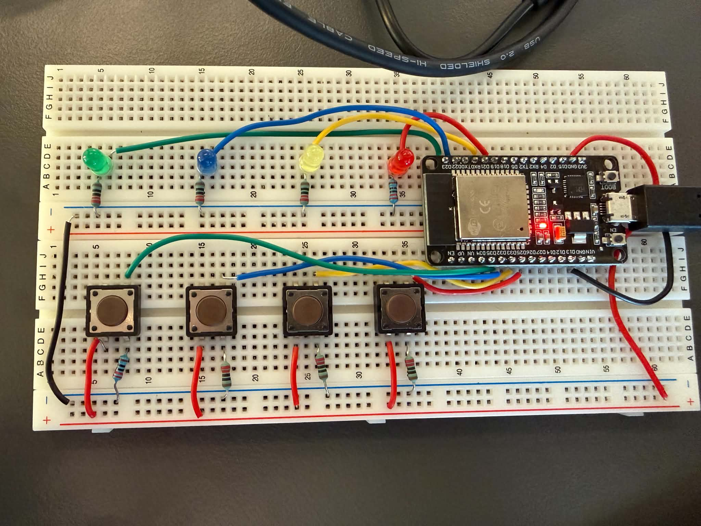
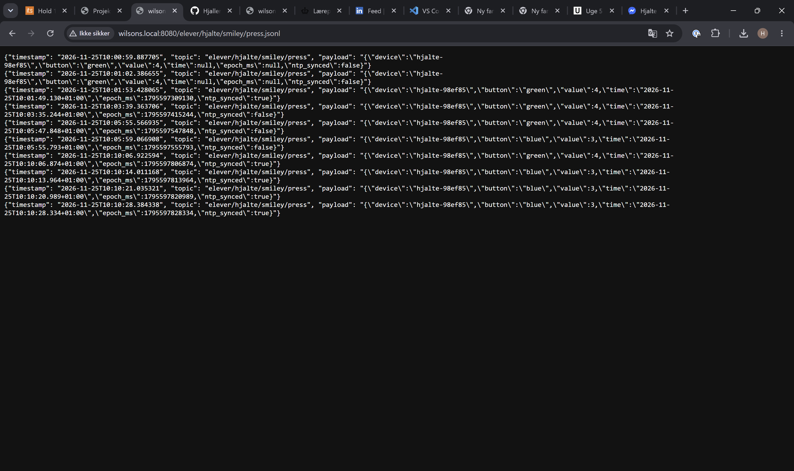

# Portfolio (kort udgave) – Smiley feedback-panel

**Fag:** IoT II (FAG 17682) · **Gruppe:** Hjalte · **Repo:** https://github.com/Hjaller/smiley_iot
**Opgave:** [Projektopgave, Smiley feedback panel](https://s0ren.github.io/FAG_17682_IoT_II/Opgaver/Projektopgave_Smiley.html)

Kort overblik over projektet. Alle målinger, beregninger og testdetaljer står i den fulde [portfolio.md](portfolio.md).

---

## 1. Idé og krav

Et feedback-panel med fire smiley-knapper fra glad til sur. Et tryk sendes med tidsstempel over MQTT, så svarene kan opsamles og analyseres.

| Krav | Løsning | Status |
|---|---|---|
| 4 knapper med smileys + LED | Grøn, blå, gul, rød – LED ud for hver knap | ✅ |
| Debounce | 50 ms stabilt signal | ✅ |
| 7 s spærretid med LED tændt | Lås styret af en `esp_timer` | ✅ |
| WiFi via klassens access-punkt | ESP32 i station-mode | ✅ |
| NTP i korrekt tidszone | SNTP, dansk tid inkl. sommertid | ✅ |
| Værdi + tid via MQTT | JSON til `elever/hjalte/smiley/press` | ✅ |
| TLS + brugernavn/kode | Port 8883, CA-tjek, login | ✅ |
| Deep sleep + forsøg og analyse | Vækkes af knap eller timer | ✅ |

---

## 2. Hardware

ESP32 DevKit V1, 4 knapper med pull-down-modstand, 4 LED'er med 220 Ω formodstand.

| Farve | Værdi | Knap (GPIO) | LED (GPIO) |
|---|---|---|---|
| Grøn (meget glad) | 4 | 32 | 23 |
| Blå | 3 | 33 | 22 |
| Gul | 2 | 25 | 21 |
| Rød (meget sur) | 1 | 26 | 19 |

Knapperne sidder på **RTC-GPIO'er**, fordi kun de kan vække ESP32 fra deep sleep.



*LED'er med formodstand øverst, knapper med pull-down-modstand nederst, ESP32 til højre.*

---

## 3. Sådan virker den

1. Et tryk vækker ESP32 fra deep sleep. LED'en tænder efter 42 ms, og trykket gemmes med tidsstempel i en kø, der overlever deep sleep.
2. WiFi, NTP og MQTT (TLS) forbindes i baggrunden. Knapper og lås kører uafhængigt af netværket.
3. Trykket sendes, når NTP har rettet tiden (højst 17 s ventetid). Kan det ikke sendes, bliver det i køen til næste vågning.
4. I 7 s ignoreres nye tryk.
5. Efter 10 s uden aktivitet går den i deep sleep. Hver 6. time vågner den selv og sender en statusbesked.

| Indstilling | Værdi | Hvorfor |
|---|---|---|
| `LOCK_MS` | 7 s | Krav i opgaven |
| `IDLE_MS` | 10 s | Laveste forbrug med margin til forsinkede beskeder (afsnit 6) |
| `ROUTINE_SLEEP_S` | 6 t | Billigt livstegn, holder uret nogenlunde (afsnit 6) |
| `NTP_WAIT_MS` | 17 s | NTP er ofte langsom; enheden er alligevel vågen i 17 s |

---

## 4. MQTT og sikkerhed

```json
{"device":"hjalte-98ef85","button":"green","value":4,"time":"2026-11-25T10:05:47.848+01:00","epoch_ms":1795597547848,"ntp_synced":true}
```

Statusbeskeder (opstart og rutine) sendes til `elever/hjalte/smiley/status`.

- **TLS på port 8883:** ESP32 tjekker brokerens certifikat mod CA'en og værtsnavnet `wilsons.local`. Ingen `setInsecure()`.
- **Login** sendes først, når forbindelsen er krypteret.
- **Hemmeligheder** (WiFi-kode, MQTT-login) ligger i `include/secrets.h`, som står i `.gitignore`.

---

## 5. Tid

- Tidsstemplet er tidspunktet for **trykket**, ikke for afsendelsen. Det rettes efter NTP, når nettet er oppe.
- ESP32's ur går **ca. 1,3 % for hurtigt** under deep sleep (8 målinger, 1,23–1,68 %). Efter 6 timers søvn er det ca. 5 min. Derfor venter firmwaren på NTP før afsendelse.

---

## 6. Deep sleep – forsøg og analyse

**Målte tider (vågnet af knaptryk):**

| | Tid |
|---|---|
| Knap fundet og LED tændt | 42 ms |
| WiFi forbundet | ca. 1,15 s |
| TLS-handshake | ca. 0,6–0,7 s (uden TLS: 45 ms) |
| Tryk → sendt | typisk ca. 4 s (NTP er den langsomste del) |
| Tryk → sendt, når den allerede er vågen | 2–3 ms |

**Strøm** er beregnet ud fra ESP32-databladet (v5.3) og vores målte tider, da vi ikke har haft måleudstyr: ca. 115 mA under opkobling, ca. 49 mA vågen, 10 µA i deep sleep.

**`IDLE_MS` (inaktiv-tid før deep sleep):**
- Det kan kun betale sig at blive vågen, hvis næste tryk kommer inden for ca. 1–6 s efter låsen, fordi en ny opvågning med TLS kun tager ca. 1,8 s.
- Vi simulerede tre brugsmønstre (20, 300 og 1000 tryk om dagen). Kortere inaktiv-tid var bedst i dem alle.
- **Valg: 10 s.** Det bruger 37–47 % mindre strøm end de oprindelige 30 s. En besked nåede i et forsøg først brokeren 11,5 s efter afsendelse, og 10 s efter sidste afsendelse giver plads til det.

**`ROUTINE_SLEEP_S` (rutine-vågning):**
- **Valg: 6 timer.** Det koster ca. 0,34 mAh om dagen, og en død enhed opdages samme dag.

**Batterilevetid** (kun ESP32-chippen, 2000 mAh, `IDLE_MS` = 10 s): ca. 336 døgn ved 20 tryk/dag, 35 døgn ved 300 og 10 døgn ved 1000. DevKit-boardets USB-chip og regulator bruger mere end chippen i deep sleep, så i praksis er levetiden kortere.

---

## 7. Test

| Område | Resultat |
|---|---|
| Hardware, knapper og LED'er | ✅ |
| Tryk sendes og modtages på brokeren (med og uden TLS) | ✅ |
| Debounce og 7 s lås | ✅ |
| Deep sleep, opvågning på knap og rutine-timer | ✅ |
| Forkert MQTT-kode | ✅ Afvist én gang, trykket gemmes |
| Langsomt/manglende net | ✅ Knapper og lås virker, trykket gemmes |
| Knap holdt nede | ✅ Ét tryk, sover 10 s efter slip |
| `IDLE_MS` = 10 s | ✅ |
| NTP-tid ved hver opvågning | ⚠️ Var for langsom med 4 s ventetid – forbedret med 17 s |
| Intet WiFi → tryk sendes ved næste vågning | ➖ Ikke udført (kunne ikke komme uden for WiFi-rækkevidde) |



*Brokerens weblog (`wilsons.local:8080`) med engelske JSON-beskeder. De to første har `"time": null` – det er fejlen fra test 17, som er rettet. De fire sidste (kl. 10:10) er sendt, mens enheden var vågen: tryk → modtaget på brokeren tog **ca. 50 ms**, og alle har `"ntp_synced": true`.*

---

## 8. Vigtigste ændringer undervejs

| Problem (fundet ved test) | Ændring |
|---|---|
| Ingen login i starten | Kørte midlertidigt uden TLS (`USE_TLS 0`), slået til igen, da vi fik login |
| Forkert kode gav 13 login-forsøg og en misvisende fejl | Afvist login prøves ikke igen i samme vågning |
| En forbindelse hang i 30 s, og LED'en lyste for længe | Timeouts på forbindelsen og lås styret af en timer |
| Ukendt værtsnavn blokerede i 15 s, og knapper blev ikke læst | Knapper og lås kører nu i en `esp_timer` uafhængigt af netværket |
| Gik i deep sleep straks, når en holdt knap blev sluppet | Slip og afsendelse tæller som aktivitet |
| Tryk lige efter strøm til blev sendt med `"time": null` | Tryk uden tid venter på NTP |
| NTP kom ofte først efter ca. 17 s | `NTP_WAIT_MS` hævet fra 4 til 17 s |
| 30 s inaktiv-tid brugte unødigt meget strøm | `IDLE_MS` sat ned til 10 s |
| Kode og JSON på dansk | Oversat til engelsk (logbog og portfolio er stadig på dansk) |

---

## 9. Brug af AI

Vi har brugt Claude Code til at læse opgaven, skrive og rette firmwaren, analysere logs og skrive dokumentationen. Vi har selv bygget hardwaren, kørt alle tests på boardet og truffet beslutningerne.

---

## 10. Mangler

- [x] Foto af opstillingen
- [x] Screenshot af weblog med de engelske beskeder
- [x] Afsnittet om brug af AI
- [ ] Commit og give læreren adgang til repoet
