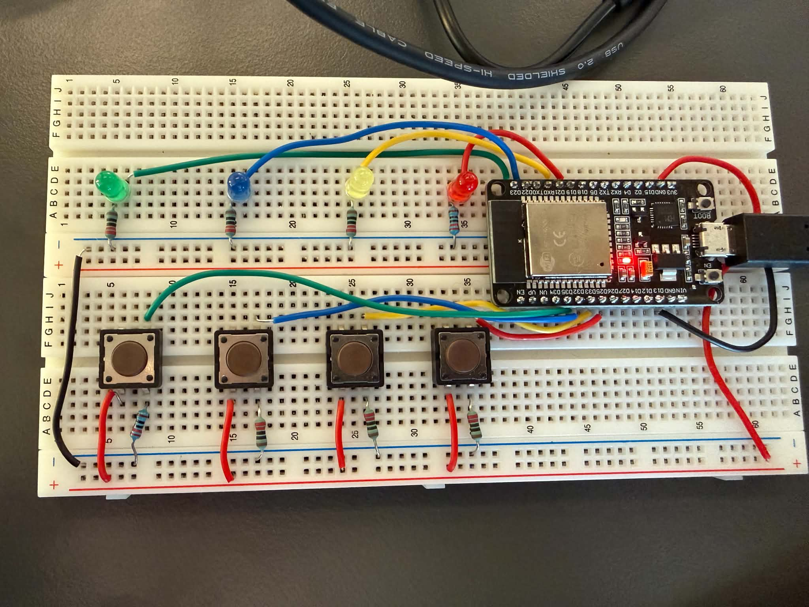
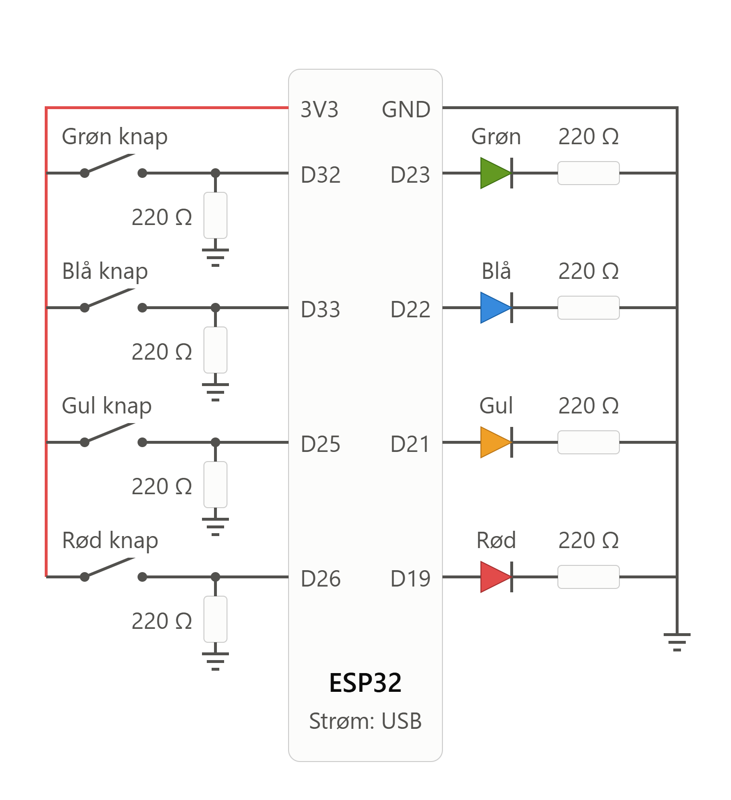

# Smiley feedback-panel – kort præsentation

**Fag:** IoT II (FAG 17682) · **Gruppe:** Hjalte · **November 2026**

Fire knapper fra glad til sur. Ét tryk bliver til et tidsstemplet datapunkt, der sendes krypteret over MQTT fra en ESP32. Det meste af tiden ligger ESP32'en i deep sleep.

Flere detaljer står i [portfolio_kort.md](portfolio_kort.md) og [portfolio.md](portfolio.md).

---

## 1. Idé og krav

Panelet minder om dem i lufthavne: man trykker én gang, og svaret sendes med tidsstempel til en MQTT-broker, så det kan analyseres. Alle otte krav fra opgaven er opfyldt:

| Krav | Løsning |
|---|---|
| 4 knapper + LED | Grøn, blå, gul og rød med en LED ud for hver |
| Debounce | Et tryk tæller først efter 50 ms stabilt signal |
| 7 s spærretid | LED'en lyser, og nye tryk ignoreres |
| WiFi | Station-mode på klassens access-punkt |
| NTP + tidszone | Dansk tid inkl. sommertid |
| MQTT | Værdi og tid som JSON |
| TLS + login | Port 8883, CA-tjek, brugernavn og kode |
| Deep sleep | Vækkes af knap eller timer, med forsøg og analyse |

---

## 2. Hardware og valg



| Valg | Hvorfor |
|---|---|
| ESP32 DevKit V1 | WiFi, TLS og deep sleep på én chip. Bruger 10 µA i deep sleep ifølge databladet |
| Knapper på RTC-GPIO 25, 26, 32 og 33 | Kun RTC-ben kan vække chippen fra deep sleep |
| Ingen strapping-ben (0, 2, 5, 12, 15) | De kan forstyrre opstarten |
| Eksterne pull-down-modstande | Holder knapperne LOW, også mens chippen sover. Et tryk læses som HIGH |
| Grøn = 4 … rød = 1 | Et højere tal betyder gladere, så man direkte kan tage et gennemsnit |

| Farve | Værdi | Knap | LED |
|---|---|---|---|
| Grøn | 4 | GPIO 32 | GPIO 23 |
| Blå | 3 | GPIO 33 | GPIO 22 |
| Gul | 2 | GPIO 25 | GPIO 21 |
| Rød | 1 | GPIO 26 | GPIO 19 |



---

## 3. Sådan virker den

1. **Vågn op:** et tryk vækker ESP32 (ext1), og LED'en tænder efter 42 ms.
2. **Gem:** trykket lægges med tidsstempel i en kø, der overlever deep sleep.
3. **Forbind:** WiFi, NTP og MQTT over TLS kobles op i baggrunden.
4. **Send:** JSON sendes, når NTP har rettet tiden. Der ventes højst 17 s.
5. **Sov:** efter 7 s lås og 10 s uden aktivitet går den i deep sleep.

Hver 6. time vågner den selv, synkroniserer med NTP og sender en statusbesked. Kan et tryk ikke sendes, bliver det i køen til næste vågning.

---

## 4. Firmware: knapperne kører i en timer og netværket i `loop()`

| Del | Kører i | Funktioner |
|---|---|---|
| Knapper og lås | `esp_timer` hver 5 ms | `readButtons()` (debounce 50 ms), `registerPress()` (LED + kø), `lockExpired()` (præcis 7 s) |
| Kø | RTC-hukommelse | 32 tryk, `RTC_DATA_ATTR`, beskyttet af en critical section |
| Netværk og søvn | `loop()`, som gerne må blokere | `handleNetwork()` (WiFi, TLS), `flushQueue()` (sender køen), `checkSleep()` (deep sleep) |

**Hvorfor:** i test 15 blokerede et DNS-opslag på et ukendt værtsnavn `loop()` i ca. 15 s. Imens gik tryk tabt, og LED'en lyste for længe. Nu kører knapper og lås uafhængigt af netværket. TLS-forbindelsen har også fået en timeout på 8 s og brokeren 5 s. Standarden er 30 og 15 s.

Projektet bruger PlatformIO, `espressif32@8.0.0`, Arduino-framework og PubSubClient 2.8. Al logik ligger i [src/main.cpp](../src/main.cpp).

---

## 5. MQTT og sikkerhed

Tryk sendes til `elever/hjalte/smiley/press`:

```json
{
  "device": "hjalte-98ef85",
  "button": "green",
  "value": 4,
  "time": "2026-11-25T10:05:47.848+01:00",
  "epoch_ms": 1795597547848,
  "ntp_synced": true
}
```

- **JSON:** felterne har navne, formatet kan læses af både mennesker og programmer, og man kan tilføje felter uden at ødelægge eksisterende modtagere.
- **TLS på port 8883:** hele forbindelsen til brokeren er krypteret.
- **CA-tjek og værtsnavn:** ESP32 forbinder til `wilsons.local` i stedet for en IP-adresse, så certifikatet kan tjekkes. Vi bruger aldrig `setInsecure()`.
- **Login først efter TLS:** brugernavn og kode kan derfor ikke opsnappes. Et afvist login prøves ikke igen i samme vågning.
- **`secrets.h` står i `.gitignore`:** kun skabelonen committes. CA-certifikatet er offentligt og må gerne ligge i git.

---

## 6. Tid

Tidsstemplet angiver tidspunktet for **trykket**, ikke for afsendelsen.

- RTC-uret går **ca. 1,3 %** for hurtigt i deep sleep (8 målinger, 1,23–1,68 %). Efter 6 timers søvn uden NTP svarer det til **ca. 5 min** fejl.
- Når NTP er synkroniseret, regnes tiden for trykket om sådan:
  `tryk = NTP-tid nu − (millis() nu − millis() ved tryk)`
- **Ventetiden på NTP er 17 s (før 4 s).** ESP-IDF venter tilfældigt 0–5 s før den første NTP-forespørgsel, og en tabt pakke prøves først igen efter 15 s. Enheden er alligevel vågen i 17 s efter et tryk, så ventetiden koster næsten intet.

---

## 7. Deep sleep: forsøg og valg

| Trin | Målt tid |
|---|---|
| Knap fundet, LED tændt | 42 ms |
| WiFi forbundet | ca. 1,15 s |
| TLS-handshake + login | 0,6–0,7 s (uden TLS: 45 ms) |
| Tryk → sendt (fra dvale) | ca. 4 s (NTP er langsomst) |
| Tryk → sendt (vågen) | 2–3 ms |
| Tryk → på brokeren (vågen) | ca. 50 ms |

Strømmen er et estimat ud fra ESP32-databladet, fordi vi ikke havde måleudstyr. Vi regner med ca. 115 mA under opkobling, 49 mA vågen og 10 µA i deep sleep. En ny opvågning med TLS tager kun ca. 1,8 s, så det betaler sig kun at blive vågen, hvis næste tryk kommer 1–6 s efter låsen. Vi simulerede tre brugsmønstre med 20, 300 og 1000 tryk om dagen i [analyse/power_estimate.py](../analyse/power_estimate.py). Kortere inaktiv-tid gav lavest forbrug i alle tre.

| Indstilling | Værdi | Hvorfor |
|---|---|---|
| `IDLE_MS` | 10 s | Bruger 37–47 % mindre strøm end de oprindelige 30 s. Der er stadig plads til en besked, der i et forsøg var 11,5 s forsinket |
| `ROUTINE_SLEEP_S` | 6 t | Giver livstegn og NTP-synk for ca. 0,34 mAh om dagen. En død enhed opdages samme dag |
| `LOCK_MS` | 7 s | Krav i opgaven. Låsen styres af en timer, så den holder, selv når nettet hænger |

**Batterilevetid** på 2000 mAh, kun for ESP32-chippen: ca. 336 døgn ved 20 tryk om dagen, 35 døgn ved 300 og 10 døgn ved 1000. DevKit-boardets USB-chip og regulator bruger mere strøm end chippen i deep sleep, så i praksis holder batteriet kortere.

---

## 8. Test, der ændrede designet

| Fundet ved test | Ændring |
|---|---|
| Et DNS-opslag blokerede `loop()` i ca. 15 s | Knapper og lås er flyttet til en `esp_timer` |
| En forbindelse hang i 30 s | Timeouts: 8 s på TLS, 5 s på svar fra brokeren |
| Forkert kode gav 13 login-forsøg | Et afvist login prøves ikke igen i samme vågning |
| Tryk lige efter strøm til fik `"time": null` | Tryk uden tid venter på NTP |
| NTP kom ofte først efter ca. 17 s | `NTP_WAIT_MS` er hævet fra 4 til 17 s |
| 30 s inaktiv-tid brugte for meget strøm | `IDLE_MS` er sat ned til 10 s |

Resultat: 8 testområder er bestået, og NTP-ventetiden er forbedret. Testen af tryk uden WiFi blev ikke udført, fordi vi ikke kunne komme uden for WiFi-rækkevidde.

---

## 9. Status og næste skridt

**Det virker i dag:**
- Hele kæden fra tryk til broker, med TLS og login.
- Deep sleep med opvågning på knap og timer.
- Ingen tryk går tabt, fordi de ligger i en kø i RTC-hukommelsen.

**Næste skridt:**
- Måle strømmen med rigtigt udstyr, da tallene i dag er estimater.
- Teste, at et tryk uden WiFi bliver sendt ved næste vågning.
- Bruge et board uden USB-chip og regulator, hvis panelet skal køre længe på batteri.

**Brug af AI:** Claude Code hjalp med firmware, log-analyse og dokumentation. Hardware, test og beslutninger er vores egne.
